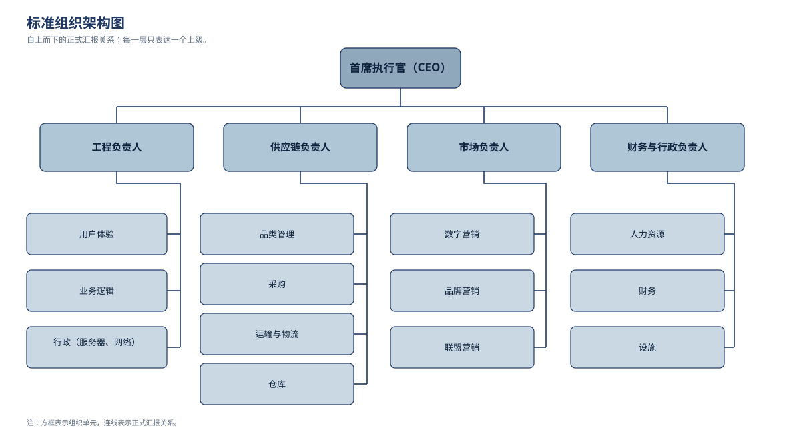
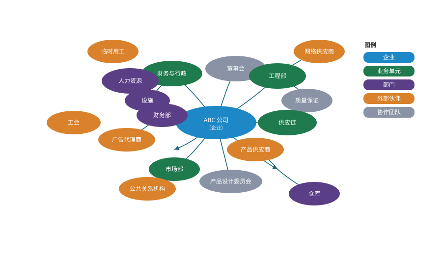
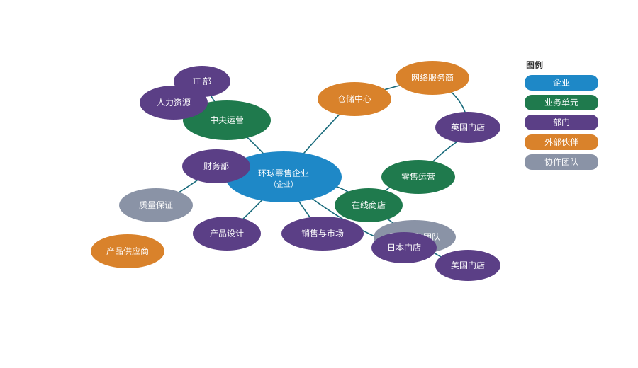

# 组织映射

**The Open Group TOGAF® 系列指南**

由 The Open Group 架构论坛业务架构工作组编写

文档编号：G206

> 中文译本说明：本文档依据 The Open Group《Organization Mapping》（G206）逐节翻译。机构名、标准号与网址保留原文；术语首次出现时附英文。

---

## 前言

### The Open Group

The Open Group 是一个全球性联盟，拥有 900 多家成员组织，通过技术标准与开源倡议，在多元成员之间培育协作、包容与相互尊重的文化，帮助各组织实现业务目标。其成员涵盖多个行业的客户、系统与解决方案供应商、工具厂商、集成商、学术界与咨询顾问。

The Open Group 的使命是推动实现**无边界信息流**（Boundaryless Information Flow™），途径包括：

- 与客户合作，捕捉、理解并应对当前及新兴需求，制定政策并分享最佳实践；
- 与供应商、联盟及标准组织合作，凝聚共识、促进互操作，推动规范与开源技术的演进与整合；
- 提供全面的服务组合，提升联盟的运营效率；
- 开发并运营业界领先的认证服务，鼓励采购通过认证的产品。

### TOGAF® 标准

TOGAF 标准是一套经过实践检验的企业方法论与框架，世界领先的组织用它来提升业务效率。

### 本文档

本文档是 TOGAF® 系列指南之一，主题为组织映射（Organization Mapping），由 The Open Group 开发并批准。

### 关于 TOGAF® 系列指南

TOGAF® 系列指南提供关于如何使用 TOGAF 标准以及如何调整标准以满足特定需求的指导。它们是 TOGAF 标准中发展最快的部分，定位为标准的“指导”部分。TOGAF 基础内容预期长期稳定；而关于标准使用的指导则可因行业、架构风格、用途和具体问题而异。无论行业、领域与风格如何，TOGAF 基础内容始终是基本的脚手架。

---

## 关于作者

（请注意：所属机构为批准时的情况。）

**Steve DuPont——波音公司副技术院士（Associate Technical Fellow）**

Steve 自 2009 年起参与 The Open Group 标准制定，是认证业务架构师（CBA®）。他是波音公司（The Boeing Company）的副技术院士兼高级企业架构师，为战略航空航天计划提供企业架构领导，例如新商用飞机项目、全球业务发展计划以及并购。

**J. Bryan Lail——雷神公司业务架构院士（Business Architect Fellow）**

J. Bryan Lail 是雷神公司（Raytheon）的业务架构院士。他是 Business Architecture Guild® 的认证业务架构师（CBA®）、The Open Group 的 Master Certified Architect，以及 Raytheon 认证架构师，在国防行业应用战略性业务架构方法。其职业生涯横跨物理研究、为美国海军与 Raytheon 从事工程工作，并发表多篇关于架构应用于业务战略的著作。

**Stephen Marshall——IBM 战略顾问**

Stephen Marshall 是 Business Architecture Guild® 的认证业务架构师（CBA®）、The Open Group 的 Master Certified Architect，以及 IBM 商业价值研究院（IBV）的高级管理顾问。他目前领导 IBV 亚太区全球 C-suite 研究项目，并合著多篇思想领导力文章。

## 致谢

（请注意：所属机构为批准时的情况。）

The Open Group 谨向本文档的作者表示感谢：

- Steve DuPont
- J. Bryan Lail
- Stephen Marshall

The Open Group 同时感谢 The Open Group 架构论坛过去与现在的成员对本文档开发的贡献，包括以下关键推动者：

- Sonia Gonzalez
- Mike Lambert

## 商标

ArchiMate、FACE、FACE 徽标、Future Airborne Capability Environment、Making Standards Work、Open Footprint、Open O 徽标、Open O and Check 认证徽标、Open Subsurface Data Universe、OSDU、SOSA、SOSA 徽标、The Open Group、TOGAF、UNIX、UNIXWARE 和 X 徽标是 The Open Group 的注册商标；Boundaryless Information Flow、Build with Integrity Buy with Confidence、Commercial Aviation Reference Architecture、Dependability Through Assuredness、Digital Practitioner Body of Knowledge、DPBoK、EMMM、FHIM Profile Builder、FHIM 徽标、FPB、IT4IT、IT4IT 徽标、O-AA、O-DA、O-DEF、O-HERA、O-PAS、O-TTPS、O-VBA、Open Agile Architecture、Open FAIR、Open Process Automation、Open Trusted Technology Provider、Sensor Integration Simplified 和 Sensor Open Systems Architecture 是 The Open Group 的商标。

A Guide to the Business Architecture Body of Knowledge、BIZBOK、Business Architecture Guild、CBA 和 Certified Business Architect 是 Business Architecture Guild 的注册商标。所有其他品牌、公司和产品名称仅用于标识目的。

## 参考文档

| 编号 | 文档 |
|---|---|
| [BIZBOK Guide] | 《A Guide to the Business Architecture Body of Knowledge》（BIZBOK® Guide），8.0 版，第 1 部分：引言，Business Architecture Guild®，2018 年 8 月；www.businessarchitectureguild.org/page/002 |
| [C220] | 《TOGAF® 标准》第 10 版（C220），The Open Group，2022 年 4 月；www.opengroup.org/library/c220 |
| [G176] | 《TOGAF® 系列指南：业务场景》（G176），The Open Group，2022 年 4 月；www.opengroup.org/library/g176 |
| [G178] | 《TOGAF® 系列指南：价值流》（G178），The Open Group，2022 年 4 月；www.opengroup.org/library/g178 |
| [G18A] | 《TOGAF® 系列指南：业务模型》（G18A），The Open Group，2022 年 4 月；www.opengroup.org/library/g18a |
| [G190] | 《TOGAF® 系列指南：信息映射》（G190），The Open Group，2022 年 4 月；www.opengroup.org/library/g190 |
| [G211] | 《TOGAF® 系列指南：业务能力》，第 2 版（G211），The Open Group，2022 年 4 月；www.opengroup.org/library/g211 |
| [Mintzberg & Van der Heyden, 1999] | Henry Mintzberg、Ludo Van der Heyden，《Organigraphs: Drawing How Companies Really Work》，1999 年 9–10 月，Harvard Business Review；www.hbr.org/1999/09/organigraphs-drawing-how-companies-really-work |

---

## 1. 引言

组织地图（organization map）是业务架构的关键要素，因为它为整个企业架构工作提供了组织上下文。能力映射（capability mapping）揭示企业“做什么”，价值流映射（value stream mapping）揭示企业“如何为特定利益相关者交付价值”，而组织地图则识别**拥有或使用这些能力、并参与价值流的业务单元或第三方**。

作为业务架构四大核心要素之一[1]，组织地图提供了一个关键视角：企业架构的组织上下文。例如，它可以显示哪些组织单元与特定的架构设计或解决方案相关。这些关键洞察使组织地图成为企业架构与战略落地的基础。

结合 TOGAF® 框架**阶段 B**（Phase B）所述方法以及相关的业务架构主题系列指南，组织地图帮助理解：应让哪些组织单元参与架构工作、就某项需求应与谁在何时沟通，以及如何衡量各类决策的影响。

**尾注**

[1] 《业务架构知识体系指南》（BIZBOK®）第 1 部分：引言，图 1.1。

---

## 2. 什么是组织地图？

组织地图是一种业务架构蓝图，它展示：

1. 构成企业生态系统的**主要组织单元、合作伙伴与利益相关者群体**；
2. 这些实体之间的**工作关系**（既有正式关系，也有非正式关系）。

这两个主要特征也体现了组织地图与传统组织架构图（organization chart）的区别：后者更倾向于描绘各部门负责人（具名个人）之间的汇报关系（详见第 3 章）。组织地图不以聚焦人员和头衔的自上而下层级来描述业务，而是以更流动的方式——把业务描绘成**企业实体之间的关系与互动网络**，这些实体甚至可以超出企业的法定边界。

组织架构图缺乏流动性，加之当今商业世界对“企业”边界的界定不断拓宽，促使明茨伯格（Mintzberg）与范德海登（Van der Heyden）提出了组织映射的概念（见 Mintzberg & Van der Heyden, 1999）。他们认为组织架构图对于理解业务、制定战略与规划正变得越来越不相关，于是提出“网”（web）的概念——与社交网络的运作方式颇为相似——认为它更适合描述组织如何跨越正式边界与部门壁垒实际运作。

> 图 2-1 为示意性的网络结构：不同颜色的节点簇通过连线相互连接，用以表达组织内部与外部实体之间非层级化的关系网络。

“组织不受公司或法律边界约束”这一观念，可能要求把组织重新定义为“为满足某种需要或追求共同目标而组织和管理起来的人群社会单元”[1]。由此推之，组织映射同样不受约束：组织地图覆盖整个企业，包括由供应商、合作伙伴与利益相关者构成的更广泛生态系统；若存在正式工作关系，甚至可以延伸到客户。因此，组织地图提供的是**整个企业**的可见性，而不仅是正式的法律实体。

组织地图中的每个节点代表一个**组织单元**（organization unit）。组织单元可以是业务单元或服务线（service line）、业务单元内的职能领域或部门、第三方合作伙伴或供应商，也可以是正式程度较低的组织形式，如协作团队（collaborative team）。协作团队通常跨职能，生命周期相对短暂——远短于组织架构图上的业务单元或部门。表 2-1 列出了组织地图中可能出现的组织单元类型与层级。

**表 2-1：组织单元类型与层级**

| 组织层级 | 组织单元 | 组织类型 | 说明 |
|---|---|---|---|
| 0 | 〈名称〉 | 企业 | 顶层实体的名称（映射范围） |
| 1 | 〈名称〉 | 业务线 | 企业内的主要汇报线 |
| 2 | 〈名称〉 | 职能 | 如市场、财务等职能领域 |
| 2 | 〈名称〉 | 合作伙伴 | 与企业内部有重要关系的外部伙伴 |
| 3 | 〈名称〉 | 协作团队 | 由两个或多个组织单元共同创建并跨单元运作的项目或团队 |

**尾注**

[1] “Organization”的定义，WebFinance, Inc.

---

## 3. 组织地图与组织架构图的区别

对不熟悉的人来说，组织地图看起来可能类似组织架构图：两者都可有相似的结构元素，都可以用节点关系图等方式表达。但二者存在显著差异。

传统的企业层级模型（如图 3-1）关注正式的、自上而下的汇报结构，而非业务的实际运作方式；因此无法描绘那些横向的、同级之间的、多对多的关系——正是这些关系通过跨业务单元、常含外部方的项目团队与工作组，支撑着企业的日常运转。

> 图 3-1 为典型组织架构图：顶端为首席执行官（CEO），下设工程、供应链、市场、财务与行政四位负责人；其下分别为用户体验、业务逻辑、行政（服务器、网络）；品类管理、采购、运输与物流、仓库；数字营销、品牌营销、联盟营销；人力资源、财务、设施。图内文字已中文化；结构据英文原图重绘。

**图内标签对照**

| 图内英文 | 中文 |
|---|---|
| CEO | 首席执行官（CEO） |
| Head, Engineering | 工程负责人 |
| Head, Supply Chain | 供应链负责人 |
| Head, Marketing | 市场负责人 |
| Head, Finance & Admin | 财务与行政负责人 |
| User Experience | 用户体验 |
| Business Logic | 业务逻辑 |
| Admin (servers, networks) | 行政（服务器、网络） |
| Category Management | 品类管理 |
| Procurement | 采购 |
| Shipping & Logistics | 运输与物流 |
| Warehouse | 仓库 |
| Digital Marketing | 数字营销 |
| Brand Marketing | 品牌营销 |
| Affiliate Marketing | 联盟营销 |
| Human Resource | 人力资源 |
| Finance | 财务 |
| Facilities | 设施 |

组织地图（如图 3-2）则更进一步：既描绘内部关系，也描绘外部关系与跨企业乃至生态系统的协作，涵盖业务伙伴与利益相关者。图中中央椭圆（企业）应理解为**地图所要表达的整体范围**，而不仅是法律实体的名称。另请注意，图中所有实体都是组织单元，而“业务单元”一词用于指代企业之下的下一层级（此例中代表各业务职能）。

组织地图与组织架构图的底层用途也不同。组织架构图通常是高层管理者与人力资源部门使用的工具，用于描绘组织的正式结构，包括汇报关系及各部门/岗位的相对等级。相反，组织地图由分析师、规划人员和架构师使用，用于描绘更丰富的组织模型——从组织单元或业务实体的视角传达内部与外部的各种关系与协作。

总之，组织地图与组织架构图的关键差异如下：

- **范围（Scope）**  
  组织架构图聚焦内部，用于向利益相关者传达企业的基本结构与汇报关系。组织地图则以整体系统为导向，准确表达企业业务模型中各关键参与者之间内部与外部的全部关系。

- **复杂性（Complexity）**  
  传统组织架构图几乎无法揭示组织内部复杂的互动与关系。组织地图更准确地描述业务单元与外部方之间的合作与协作关系；这种对关键关系的更丰富描述，有助于理解业务条件变化或业务模式动态可能如何影响整体运营与交付能力。

- **显性程度（Explicitness）**  
  组织架构图通常局限于对各部门负责人（具名个人）之间显性、正式关系的表达。组织地图则包含对业务至关重要的**隐性关系**，例如拟议业务模式变革中会影响价值交换的参与者。

- **生命周期（Lifecycle）**  
  二者的生命周期与流动程度不同。例如，业务模式的改变可能影响组织地图，却不影响组织架构图——后者更聚焦内部，相对稳定。

---

## 4. 组织映射的影响与收益

组织映射的收益包括：

- **增进对组织的理解**  
  传统组织架构图几乎不揭示组织内部的互动与关系。以其典型的内部聚焦，组织架构图难以描述业务单元与外部方之间的合作或协作关系。仅依赖简单的组织架构图，组织知识的缺失会使组织难以判断哪些业务单元可能受到业务条件变化的影响、以及如何受影响，规划人员往往只能依靠集体经验来弥补认知空白。组织地图提供了必要的组织透明度，用以识别并恰当接触受影响的业务单元。

- **改进战略规划**  
  组织地图是整体化、集成化战略规划与投资分析的重要组成部分。过去，业务单元常常各自为政地做规划，错失了理解自身发起的变革举措如何影响其他组织（以及反之）的机会，导致举措因缺乏跨组织规划、协调与资金支持而次优化甚至失败。组织映射使组织能够及早识别并接触所有受战略变革影响的业务单元，从而大幅改进战略规划与投资分析。

- **为落地部署提供组织上下文**  
  组织地图为描述业务能力、架构设计与解决方案对受影响业务单元的适用性奠定基础。对于力求在众多不同业务单元之间最大化资产复用的超大型组织，这一点尤为关键。组织地图有助于回答：某项需求、架构设计或解决方案适用于哪些业务单元？会影响哪些业务单元？业务能力应如何在多个业务单元之间部署？

- **改进沟通与协作**  
  作为业务架构的核心要素，组织地图在提供有效沟通与协作所需的透明度方面发挥关键作用。其主要目标之一是识别哪些组织会受某项规划活动或变革举措影响——这是沟通计划与利益相关者分析的关键输入；另一目标是识别哪些组织需要协作，以实现举措的目标。

- **提升组织变革管理的有效性**  
  通过让受拟议变革影响的业务单元“可见”，组织地图有助于准备并支持受影响的业务单元和个人顺利接受变革。结合业务交互矩阵、角色目录、参与者/角色矩阵等更细化的制品，组织地图是识别组织变革管理影响、定义岗位职能与开展培训的关键输入。

---

## 5. 与业务能力、价值流和信息地图的关系

第一步是用表格描述常与组织单元等组织要素相关的元素。如表 5-1 所示，组织地图从一个命名映射范围的中央构造开始；第二行中，组织单元（或业务线、事业部）是直接构成企业的要素。下一步通常是描述业务能力，勾画哪些组织单元拥有哪些业务能力（多对多映射）——这是一个强有力的构造，有助于理解权责、投资、信息流与变革管理方面的诸多问题。

不过，独立于业务能力映射，组织单元还可以与位置或其他属性建立关系；这些属性可在单元之间做出有意义的区分，但其本身并非组织要素。第五行展示组织单元之间以有形或无形形式流动的**价值流**（value flow；此处指价值在单元之间的流动，而非 Value Stream 即“价值流”概念）；这里也可以展示在组织单元之间流动的关键**信息类型**，第 7 章给出了一些示例。请注意，这些关系通常按架构工作的需要建立其中一部分，而很少全部建立。最后，这种表格还能帮助理解架构知识库中各制品之间可能的关系，包括这些关系是直接的，还是通过其他制品推导而来。

**表 5-1：组织地图与其他领域的关系**

| 元素 | 类型 | 关系 | 用途 | 示例 |
|---|---|---|---|---|
| 企业范围 | 组织 | 直接 | 组织地图的基础，界定边界范围 | 业务实体及扩展团队（含客户与战略伙伴）的名称 |
| 组织单元 | 组织 | 直接 | 企业分解为组织单元 | 市场、财务、供应链、人力资源 |
| 业务能力 | 能力 | 直接 | 组织单元拥有一项或多项业务能力 | 市场管理、财务管理、供应商管理 |
| 位置 | 地理 | 直接 | 组织单元拥有一个或多个位置 | 全球与区域位置 |
| 价值流（value flow） | 价值 | 派生 | 通过组织单元之间带标签的连线刻画，标明从一方流向另一方的价值 | 产品交付、付款审批、个性化服务 |
| 信息流 | 信息 | 派生 | 通过组织单元之间带标签的连线刻画，标明从一方流向另一方的信息 | 产品属性、付款条件、协议 |

---

## 6. 结合 TOGAF 标准使用组织地图

对于只关注业务蓝图的业务架构师，组织地图可以是一个纯粹的业务构造，用以表达构成企业的主要实体、合作伙伴与利益相关者之间的关系。对于企业架构师——他们把业务架构视为充分刻画业务需求与关注点、再由技术加以解决的阶段——组织地图则是识别架构阶段所产生解决方案之利益相关者的手段。

TOGAF 框架将**利益相关者**定义为“对系统拥有利益的个人、团队、组织或其类别”，因而关注推动企业架构焦点与范围所需的组织理解[1]，以及识别对技术解决方案的接受与使用至关重要的利益相关者。业务架构师的组织地图，在使用技术解决方案的语境下，也与 TOGAF 的运行议题（如业务参与者、角色或流程）相关。

TOGAF 框架在**阶段 A** 与**阶段 B** 引入该主题，从而在两个语境中支持组织地图的使用。在阶段 A，架构师查找并使用已有的组织描述，哪怕只是传统组织架构图的形式；在阶段 B，架构师构建组织地图，补充确保业务需求被理解所需的细节以及与其他视图的关系。元模型也引入了“组织”实体（使用术语“组织单元”），它与其他实体存在关系，如交付业务能力、交付产品、实现业务功能。

运用本指南，企业架构师可以在组织实体、业务能力与信息概念之间画出丰富得多的关系，从而为实施系统、应用、数据模型与基础设施铺路。这样的蓝图（如第 5 章的一般示例或第 7 章的应用示例）指导我们理解：可能由新增或更新技术部分解决的业务能力差距，如何与可能牵扯关键利益相关者的组织要素相关联，以及技术解决方案应支撑哪些关键信息概念。请注意“部分”一词所提示的另一个关键点：在设计解决方案之前先做业务架构，是因为极少有业务问题能仅靠技术解决。正如《业务能力》[G211]、《信息映射》[G190] 与《价值流》[G178] 等相关 TOGAF® 系列指南所述，经过深思熟虑并与这些领域关联的组织地图，有助于确保以流程变革、角色与职责、数据采集以及通过应用和基础设施实现的技术的最佳组合，真正解决业务问题。

**尾注**

[1] 《TOGAF® 标准——ADM 技术：利益相关者管理》（见 C220）。

---

## 7. 组织地图的实践应用

延续业务架构 TOGAF® 系列指南中一直使用的零售业务示例，一家全球零售企业的典型组织地图如图 7-1 所示。

再次提醒：中央椭圆（企业）应理解为地图所要表达的整体范围，而不仅是法律实体的名称；图中所有实体都是组织单元，而“业务单元”用于指代企业之下的下一层级（此例中代表各业务线或渠道）。

组织地图不仅让人一眼看清业务在组织层面与运营层面如何运作，还可以扩展用来展示组织单元与其他业务架构领域（如业务能力）之间的关系。图 7-2 在图 7-1 的组织地图上叠加业务能力框：IT 组织单元的 Project Management 能力与 Sales & Marketing 的 Learning Management 能力进行交叉映射（原文图中 IT 侧的能力框标注为 Product Management）。可对每项能力施加热力图着色，以直观显示绩效、成熟度或其他相关属性。

> 图 7-2：组织单元与业务能力的交叉映射。图内文字已中文化；原图见英文原文 Figure 7-2。

**图内标签对照**

| 图内英文 | 中文 |
|---|---|
| Key | 图例 |
| Enterprise | 企业 |
| Business Unit | 业务单元 |
| Department | 部门 |
| External Partner | 外部合作伙伴 |
| Collaborative Team | 协作团队 |
| Business Capability | 业务能力 |
| Global Retail Enterprises, Inc. | 全球零售企业公司 |
| Central Operations | 中央运营 |
| HR | 人力资源 |
| Finance | 财务 |
| IT | IT |
| Quality Assurance | 质量保证 |
| Product Design | 产品设计 |
| Product Suppliers | 产品供应商 |
| Sales & Marketing | 销售与市场 |
| Retail Strategy Team | 零售战略团队 |
| Retail Operations | 零售运营 |
| Online Store | 在线商店 |
| Web Services | Web 服务 |
| Warehouse | 仓库 |
| US Stores | 美国门店 |
| UK Stores | 英国门店 |
| Japan Stores | 日本门店 |
| Product Management | 产品管理 |
| Learning Management | 学习管理 |

---

## 8. 结论

组织地图是一种业务架构蓝图，展示构成企业生态系统的关键组织单元、合作伙伴与利益相关者群体。组织单元及其关系的识别，构成业务架构四大关键支柱之一。组织地图识别拥有或使用业务能力的业务单元或第三方，这些单元参与价值流，并与业务信息概念存在关系。将这四大支柱及其地图纳入企业架构工作的范围，并在各支柱之间建立恰当的映射关系，可以确保完整企业架构的范围与触达被充分理解，从而为后续跨流程、角色、技术（应用、基础设施）与数据模型的解决方案奠定基础。

---

## 索引

> 原文为页码索引；中文版重新排版后页码不适用，以下按章节号定位。

| 中文术语 | 英文 | 章节 |
|---|---|---|
| 架构知识库 | architecture repository | 5 |
| 业务架构 | Business Architecture | 1 |
| 业务架构蓝图 | Business Architecture blueprint | 2 |
| 业务能力 | business capability | 4 |
| 业务能力差距 | business capability gap | 6 |
| 业务实体 | business entity | 3 |
| 业务模型 | business model | 3 |
| 业务单元 | business unit | 1 |
| 能力映射 | capability mapping | 1 |
| 协作团队 | collaborative team | 2 |
| 企业架构 | Enterprise Architecture | 1 |
| 企业生态系统 | enterprise ecosystem | 2 |
| 信息流 | information flow | 5 |
| 信息地图 | information map | 5 |
| 位置 | location | 5 |
| 组织架构图 | organization chart | 2 |
| 组织地图 | organization map | 1 |
| 组织映射 | organization mapping | 2 |
| 组织单元 | organization unit / organizational unit | 1 |
| 组织变革管理 | organizational change management | 4 |
| 合作伙伴 | partners | 2 |
| 汇报关系 | reporting relationship | 2 |
| 服务线 | service line | 2 |
| 利益相关者 | stakeholder | 1 |
| 战略规划 | strategic planning | 4 |
| 价值流 | value stream | 1 |
| 价值流映射 | value stream mapping | 1 |

---

*译本依据：The Open Group, TOGAF® Series Guide: Organization Mapping, Document No. G206.*
