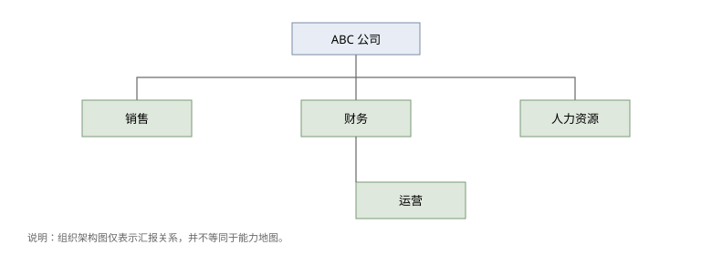
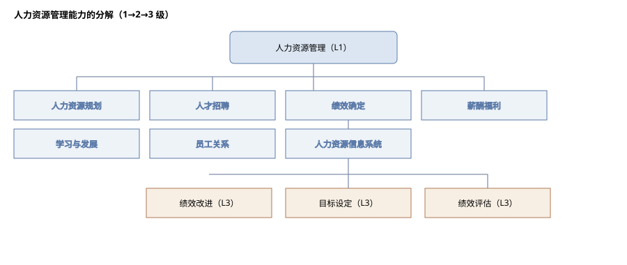
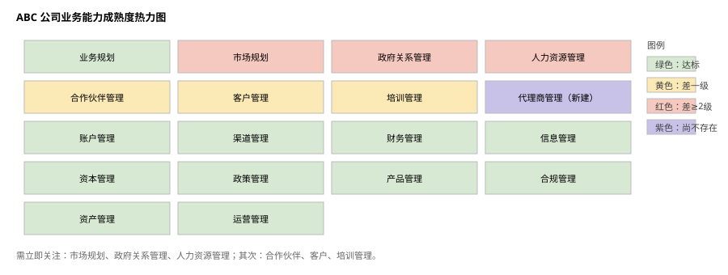
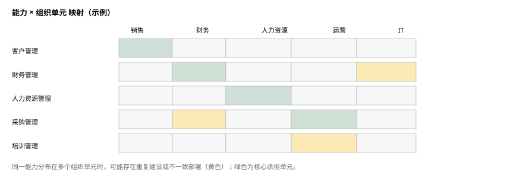
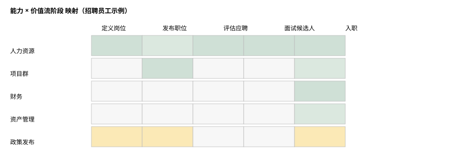

# 业务能力

**The Open Group TOGAF® 系列指南（第 2 版）**

文档编号：G211

> 中文译本说明：本文档依据 The Open Group《Business Capabilities, Version 2》（G211）逐节翻译。术语：Business Capability=业务能力；Business Capability Map=业务能力地图；Value Stream=价值流；Stakeholder=利益相关者；Business Object=业务对象。

---

## 前言

### The Open Group

The Open Group 是一个全球性联盟，拥有 900 多家成员组织，通过技术标准与开源倡议，帮助各组织实现业务目标。其成员涵盖客户、系统与解决方案供应商、工具厂商、集成商、学术界与咨询顾问。The Open Group 的使命是推动实现**无边界信息流**（Boundaryless Information Flow™）。

### TOGAF® 标准与本文档

TOGAF 标准是一套经过实践检验的企业方法论与框架。本文档是 TOGAF® 系列指南之一，主题为业务能力，由 The Open Group 开发并批准。

### 关于 TOGAF® 系列指南

TOGAF® 系列指南提供关于如何使用 TOGAF 标准以及如何调整标准以满足特定需求的指导，是标准中发展最快的“指导”部分。TOGAF 基础内容长期稳定；关于标准使用的指导则可因行业、架构风格、用途与问题而异。

### 目标读者

本文档的目标读者是各类架构师、业务领导者以及 TOGAF 框架的一般用户。

---

## 关于作者

本指南由 The Open Group 架构论坛（Architecture Forum）的业务架构工作流（Business Architecture Work Stream）开发。

（以下所属机构为文档批准时的信息。）

**Alec Blair —— 企业架构项目负责人（Program Lead, Enterprise Architecture），Alberta Health Services**

Alec 在 IT 行业从业 28 年，其中最近 15 年一直担任企业架构师以及企业架构经理/教练。Alec 目前领导 Alberta Health Services 的企业架构专家社区，并且是认证业务架构师（Certified Business Architect，CBA®）。这个虚拟团队拥有 40 多名从业者，从事企业架构各个维度的工作。

**J. Bryan Lail —— 业务架构会士（Business Architect Fellow），Raytheon**

J. Bryan Lail 是 Raytheon 的业务架构会士。他是 Business Architecture Guild® 的认证业务架构师（CBA®）、The Open Group 的大师级认证架构师（Master Certified Architect），也是 Raytheon 认证架构师，在国防行业应用战略性业务架构方法。他的职业生涯横跨物理学研究、为美国海军与 Raytheon 从事工程工作，以及多篇关于将架构应用于业务战略的出版物。

**Stephen Marshall —— 战略顾问（Strategy Consultant），IBM**

Stephen Marshall 是 Business Architecture Guild® 的认证业务架构师（CBA®）、The Open Group 的大师级认证架构师，以及 IBM 商业价值研究院（IBM Institute for Business Value，IBV）的高级管理顾问。他目前领导 IBV 亚太区的全球高管研究（Global C-suite Study）项目，并合著了多篇思想领导力文章。

## 致谢

（以下所属机构为文档批准时的信息。）

The Open Group 衷心感谢下列人士对本文档开发的贡献：

- Frédéric Lé —— DXC Technology

The Open Group 衷心感谢下列人士对本文档第一版开发的贡献：

- Sonia Gonzalez —— The Open Group
- Kirk Hansen —— Metaplexity Associates
- Harry Hendrickx —— HPE
- Rich Hillard —— ISO/IEC/IEEE 42010 项目编辑
- Chalon Mullins —— Business Architecture Guild
- Gerard Peters —— Capgemini
- Jim Rhyne —— Business Architecture Guild
- Pieter Steyn —— Enterprise Architects

---

## 商标

ArchiMate、TOGAF、The Open Group 等名称与标识归其各自所有者；Boundaryless Information Flow 为 The Open Group 商标。BIZBOK 与 Business Architecture Guild 为 Business Architecture Guild 的注册商标。

## 参考文档

| 编号 | 文档 |
|---|---|
| [C220] | 《TOGAF® 标准》第 10 版 |
| [G233] | 《TOGAF® 系列指南：业务能力规划》 |
| [BIZBOK Guide] | 《业务架构知识体系指南》（BIZBOK®） |
| [Homann, 2006] | Ulrich Homann，业务能力定义相关文献 |

---

## 1. 引言

许多组织在管理业务复杂性方面举步维艰。它们希望回答关于战略目标实现进度的问题：战略投资是否投向了正确的地方？是否存在适合整合的冗余或重复？企业是否具备成功所需的条件，或者是否拥有过多？

随着业务架构学科与实践的不断发展与成熟，“**业务能力**”概念已成为业务架构开发中的基础组件。业务能力地图是业务架构的四大核心要素之一，与价值流地图、信息地图、组织地图并列（参见《业务架构知识体系指南》[BIZBOK® 指南]）。

业务能力以某种方式对业务现实进行抽象，帮助简化相关利益相关者之间的对话。定义业务能力的支撑组件（人员、流程、信息与有形资源），为这些支撑组件提供业务语境；为企业创建业务能力地图，则有助于形成对业务的共同理解。

定义业务能力与能力地图是达成目的的手段。理解企业的能力，为架构师与规划者做出更好的业务决策奠定基础。这种洞察来自把业务能力映射到不同的业务视角；映射使更连贯的业务视图得以呈现。

本文档试图回答关于业务能力是什么、以及如何用它增强业务分析与规划的一些重要问题：

- “业务能力”究竟指什么？
- 为什么业务能力是业务架构、企业架构及架构开发过程中不可或缺的部分？
- 如何描述业务能力？
- 如何（以及为什么）构建业务能力地图？
- 业务能力如何映射到其他业务视角？

---

## 2. 什么是业务能力？

在 The Open Group 内，**能力**（capability）被定义为“做某事的能力”。业务能力表示企业做某事的能力。更正式的定义如下：

根据 Ulrich Homann [Homann, 2006]：“**业务能力是企业为达成特定目的或成果而可能拥有或交换的某种特定能力或才能。**”

关键在于：业务能力界定企业**做什么**，而不试图解释**如何做、为什么做、在哪里做**。

作为业务架构实践的一部分，我们把“我们做什么”与“组织内谁来做”、“业务如何通过该活动实现价值”区分开来。业务能力可以是今天已经存在的，也可以是为支撑新方向或新战略而所需的。整合进业务能力地图后，业务能力代表企业可用于经营业务的全部能力。

### 2.1 定义业务能力

定义业务能力包括识别并描述企业为支持其整体使命需要做什么。业务能力描述并不暗示某事需要做得多好，只表示它需要存在。以下准则说明如何定义单个业务能力。

#### 2.1.1 命名约定

命名为业务能力定义过程的第一步。它确立业务能力存在的清晰必要性，并有助于确保与其他业务能力清晰区分。

命名约定采用“**名词—动词**”格式：每个成果（输入、输出或交付物）用名词描述，与产出、控制或监控该成果相关的活动用动词描述；例如“项目管理”（Project Management）或“战略规划”（Strategy Planning）。名词部分是**唯一的业务对象**——业务所关注的单一、持久的事物。把业务对象作为业务能力焦点的好处是：它简化了识别与该能力绑定、并被其使用的信息对象的过程。

业务对象通常是有形的（如“客户”或“贷款”），但也可以更概念化、无形（如“研究”）。最重要的考虑是使用能引起业务领导者和利益相关者共鸣的名称；通俗易懂的名称能增进理解、改善跨利益相关者群体的沟通。但要抵制直接照搬组织部门名称的冲动：与业务能力（本质上稳定）不同，组织结构并不持久，在多数组织中频繁变化。

#### 2.1.2 描述

简短描述有助于澄清业务能力的范围与目的，并将其与其他业务能力区分开。一个有用的句式是把每项业务能力描述为“……的能力（或才能）”。例如，名为“战略规划”的业务能力可描述为“制定并维护组织战略计划与总体方向的能力”。

与名称一样，所有描述都应使用与业务利益相关者相关且恰当的语言。两个重要考虑是：

1. **简洁**：用一两句话提供恰到好处的细节，使理解超过仅凭名称所能获得的程度；
2. **精确**：不要在描述中简单重复业务能力的名称，例如在描述“项目管理”时写“管理项目的能力”。

### 2.2 实现业务能力的要素

角色、流程、信息与工具的组合使业务能力得以实现。审视各业务能力组件的过程，有助于细化能力名称与描述，并支持后续对能力差距、重复与冗余的分析。这种分解可作为检验：确认所定义的确是业务能力（而不是流程、组织职能或服务）。

业务能力是粗粒度的概念，支持从不同视角进行业务规划。业务能力聚焦企业“做什么”，而非“如何利用能力交付价值”。尽管如此，为了定义一项能力，我们需要理解该能力如何以人员、流程、信息与资源的形式实现。关键区别在于：业务能力的要素可以经常变化，而业务能力本身能在更长的规划周期内持续存在。能力的“如何做”必须自包含在该能力之内。

#### 2.2.1 人员

人员代表参与交付业务能力的个体参与者、利益相关者、业务单元或合作伙伴。单一组织群体或团队可完全负责交付该能力，也可由多个业务实体共同交付某项业务能力。不要以组织特有的方式描述人员。针对具体角色的业务能力应加以审视，因为它们可能只是另一项业务能力的组成部分，或需要进一步细化才能成为描述更完整的业务能力。

#### 2.2.2 流程

单个业务能力可通过一系列业务流程来使能或交付。识别并分析底层流程的效率，有助于优化业务能力的有效性。识别能力内的流程，为能力与其他组件协同成熟提供着力点。

#### 2.2.3 信息

信息代表业务能力所需或消耗的业务数据、知识与洞察（区别于 IT 相关的数据实体）。能力还可能与其他能力交换信息，以支持价值流的执行。示例包括关于客户与潜在客户、产品与服务、业务政策与规则、销售报告以及绩效指标的信息。

#### 2.2.4 资源

业务能力依赖一系列工具、材料与资产才能成功执行。这些资源可包括：

- 信息技术系统与应用；
- 有形资产，如建筑、机械与车辆；
- 无形资产，如资金与知识产权。

---

## 3. 业务能力映射

业务能力地图表示覆盖相关业务、企业或组织单元的**完整、稳定的业务能力集合**（及其全部定义特征）。建模过程的最终产物通常是业务能力地图，它在适当分解层级上对所有业务能力进行可视化描绘（或蓝图），并逻辑分组为不同类别或视角，以支持有效的分析与规划。

一旦定义，业务能力地图提供自包含的业务视图，独立于当前组织结构、业务流程、IT 系统与应用以及产品/服务组合。然而，把业务能力反向映射到组织单元、价值流、IT 架构以及战略与运营计划，将更深入地揭示各领域的对齐与优化情况。

### 3.1 方法

业务能力映射的第一个目标是捕获并记录所有业务能力，完整反映企业**今天所做**（不论做得多好）或**未来希望能够做**的全部范围。第二步是以合乎逻辑的方式组织这些信息（见 3.2 节）。

识别初始能力集有两种方法：自上而下与自下而上。

- **自上而下**：从企业层面识别 20 至 30 项最高层业务能力，每项均可分解为更细层级。高层业务领导者可协助初步开发顶层能力。实践中，自上而下起草能力地图更能有效利用时间，但通常只有高管实质性参与才能成功。
- **自下而上**：时间更充裕时，可从业务各部分定义能力并自下而上构建。但若缺乏强有力的治理与高层领导支持，这种方法在跨业务协调上更困难，最终仍需形成企业级能力地图。

通常，自上而下与自下而上相结合可细化能力地图。无论采用哪种方法，创建初稿都有三个良好信息来源：

- 组织结构；
- 业务模式；
- 当前的战略、业务与财务计划。

#### 3.1.1 组织结构

组织往往按与业务能力相近的方式构建：人员执行流程并分配资源或工具（资金、IT 或其他公司资产）。因此，组织结构可用于启发能力地图。

常见错误是把组织架构图直接套用到业务能力地图的框架上。通常，多个业务单元会共同参与创造或交付同一项业务能力；组织结构本身也比业务能力更具临时性。应尽可能避免用表示业务单元的功能名称与顶层业务能力紧密对齐。

例如，ABC 公司有四个主要职能领域，每个领域下有向父级业务单元汇报的较小部门，如图 3-1 所示。

与组织架构图中各业务单元负责人初步调研后，得到如下初始能力集（名称已按上述命名准则调整）[1]：

- **销售**：账户管理、客户管理、市场规划、渠道管理、合作伙伴管理、代理商管理
- **财务**：财务管理、IT 管理
- **人力资源**：人力资源管理
- **运营**：资本管理、政策管理、产品管理、政府关系管理、分销管理、采购管理、运营管理、培训管理

组织结构虽大致与能力对齐，但并不完美。组织中常见能力的重复或孤岛，因为组织并不清晰地对应业务对象。因此，需要分析初始能力集，识别业务对象并细化能力地图，使之更好地对齐业务对象。

审视上述初始能力集，有些情况下“起作用的业务概念”并不清晰：

- **IT 管理**：IT 通常是处理信息技术系统各方面的组织，因而常是重复的来源——IT 可能拥有自己的财务、人力资源等能力。若问与 IT 相关的新业务对象/概念是什么，最清晰的概念是“**信息**”。
- **分销管理与采购管理**：分销与采购最好被视为价值流中的阶段。问题是：分销什么？采购什么？采购通常是采购资产；分销可以是资产或产品。产品管理已是既定能力，而**资产管理**则是新的。
- **政府关系管理**：问题在于“关系”是模糊概念，涵盖多种概念。例如，可能是试图影响立法的游说活动，也可能是确保组织遵守监管要求的合规工作。因此，**监管合规管理**是潜在能力；通过游说影响法规可视为该能力的一个方面。
- **业务规划**：有些能力与组织中的特定业务单元没有清晰对应，因而在基于组织结构的分析中可能被遗漏。战略业务规划可能由多个业务单元在不同层级开展，其中没有一个把业务规划作为唯一甚至主要职责。

经过分析，得到如下一级能力候选清单：

- **ABC 公司**：业务规划
- **销售**：账户管理、客户管理、市场规划、渠道管理、合作伙伴管理、代理商管理
- **财务**：财务管理、信息管理
- **人力资源**：人力资源管理
- **运营**：资本管理、政策管理、产品管理、监管合规管理、资产管理、运营管理、培训管理

这一细化程度有助于识别跨组织单元的能力重复、冗余或缺口。

#### 3.1.2 业务模式

业务能力是执行组织业务模式的构建块。若已有总体业务模式，可据此推导出支撑各核心业务模式要素的单项业务能力。把单项业务能力反向映射到业务模式，还能确保组织的活动与投资紧密对齐，或以支持企业总体愿景与战略为目标。

#### 3.1.3 战略计划、业务计划与财务计划

使用已发布的战略计划与运营业务计划，识别组织视为战略性或核心的任何业务能力。这些业务能力能够提供竞争优势，或属于企业所针对的特定行业与市场所独有的核心竞争力。

对业务财务计划的评估还应突出企业运营所必需的其他业务能力，尤其是消耗大量财务资源的那些能力。

### 3.2 构建业务能力地图的结构

把业务能力集合转化为能向不同利益相关者群体传达恰当细节的逻辑结构，有两个概念：**分层**（stratification）与**分级**（leveling）。创建这些结构可使各群体聚焦于对其影响范围最重要或最相关的那些能力。

#### 3.2.1 业务能力分层

分层是把业务能力分类、分组并对齐到类别、层级或层次中的过程。其目的是拆解能力地图以便更易理解：20 至 30 项能力若不分层，阅读与处理都很困难。

每个分层为不同利益相关者群体提供不同视角或焦点，使其能以更有结构的方式组织分析与规划。例如，顶层通常面向高管的控制范围：与战略和方向设定相关的能力；中层通常代表面向客户的核心业务要素；底层则处理企业运转所必需、但在幕后起支撑作用的能力。

图 3-2 是 ABC 公司的一级业务能力地图示例，综合了上一节讨论的全部输入。

#### 3.2.2 分级

分级是把每项顶层（一级）业务能力分解为更低层级，以适合相关受众或利益相关者群体的详细程度进行沟通。有些能力在建模过程中会自然分解，另一些只有在能力映射到其他视角时才显现。

例如，高管可能只关心能力地图的一级视图；架构师与规划者则期望更高的粒度。分解层数只受“传达目标受众所需信息、或使企业能就能力差距做出知情决策”的必要程度限制。实践中常见三到六级。

图 3-3 展示人力资源管理能力的分解：人力资源管理为一级能力，下含七个二级能力，其中“人力资源绩效测定”又分解为三个三级能力。

**尾注**

[1] 该清单并非可能能力的完整列表——如同任何首轮工作，时间不足以会见所有利益相关者群体，或信息不足以定义某项能力。

---

## 4. 业务能力映射的影响与收益

作为业务架构蓝图的基础部分，业务能力地图可在战略层面、企业范围或单个项目层面带来收益。对企业架构师而言，能力地图的用途仅受架构工作范围本身约束，且通常始于此前在广泛业务范围内的工作。

部分影响与收益包括：

- 提供关于企业“做什么”的共同词汇，且不依赖特定组织单元、业务流程或技术；
- 使业务关系可以按“有多少领域关联到同一项业务活动能力”来理解；
- 通过映射到相同业务能力，聚焦投资与成本节约；
- 通过回溯到共同的能力视图，把项目相互关联；
- 在提出可能不正确或不完整的解决方案之前，确保利益相关者就“要交付哪些能力”达成一致；
- 确定哪些能力为价值流各阶段提供价值交付手段。

关于把业务能力地图用于组合与项目管理的强有力用例，参见《TOGAF® 系列指南：业务能力规划》[G233]。该文档描述**基于能力的规划**，即在目标与目的、组织能力以及变革举措之间建立视线贯通的方法。Business Architecture Guild 进一步阐述了相关收益与原则[1]。

**尾注**

[1] 参见 www.businessarchitectureguild.org。

---

## 5. 把业务能力映射到其他业务架构视角

把业务能力识别并组织成能力地图后，即可开始把信息应用于业务分析与规划。需要考虑两个方面：

1. 对业务能力地图本身进行**热力映射**；
2. 映射业务能力与其他业务及 IT 架构领域之间的关系。

热力映射有助于识别业务改进或投资机会，直观突出表现欠佳、或可能尚不具备未来战略所需形态的能力。第二种方法有助于加强业务各部分的协同，确保企业想做之事：

- 反映在公司的战略与运营计划中（“为什么”）；
- 得到适当的系统、流程、信息与组织结构的支撑（“如何”与“何处”）。

### 5.1 热力映射

热力图可展示多种视角，包括成熟度、有效性、绩效，以及每项能力对业务的价值或成本贡献。不同属性决定能力地图上各能力的颜色。通常采用“红绿灯”隐喻，一眼看出需要关注的能力。例如，能力成熟度热力图中，达到期望成熟度为绿色；差一级为黄色；差两级及以上为红色；其他颜色可表示其他状态，例如紫色表示该能力今天不存在但未来需要。能力缺失意味着重大差距。

图 5-1 展示从能力成熟度视角审视 ABC 公司业务能力的热力图。

可见，市场规划、政府关系管理与人力资源管理需要立即关注；合作伙伴管理、客户管理与培训管理存在一些问题但优先级较低；代理商管理是企业希望发展的新能力。业务领导者可据此确保投资与项目举措按适当水平排序并获得资金，把紫色、红色或黄色能力提升到期望成熟度。

根据业务希望采用的标准、视角或镜头，可从同一能力地图生成不同热力图。其他热力映射示例包括：

- 战略贡献；
- 绩效/有效性；
- 收入贡献；
- 成本贡献；
- 覆盖度（每项能力被一个以上业务单元使用的程度）；
- 关键性（Criticality）。

### 5.2 关系映射

业务能力与组织单元、价值流、信息资产以及业务与企业架构的所有其他域之间存在关系。业务能力分析与基于能力的规划必须识别并评估这些关系的强弱，以形成对业务的完整视图，并分离出应作为改进目标的领域。

业务能力地图可映射到其他业务架构视角，例如组织、价值流与业务流程，以揭示对齐与优化机会。从业务规划角度看，三种最常见且最有用的映射是能力/组织映射、能力/价值流映射与能力/业务流程映射。

#### 5.2.1 能力/组织映射

许多业务能力只对应组织中唯一的一个部分；在组织多个部分执行同一能力，有时会导致部署不一致与低效。前面通过组织架构图识别能力的示例中，每项能力都对应特定业务单元，未考察重复能力。图 5-2 的矩阵展示了同一业务能力如何存在于不同组织单元。

作为附加维度，能力热力图可显示在组织中整合或统一能力的机会。一种选择是在能力内标准化使用一致的工具集；另一种选择是把能力围绕特定组织单元彻底重新对齐，以优化能力的全部组件。

#### 5.2.2 能力/价值流映射

价值流代表组织为响应客户请求而开展的一系列活动（或价值阶段）。这里的客户可以是外部客户，也可以是负责支持组织价值交付的内部利益相关者。

价值流帮助企业识别创造并交付客户价值需要哪些具体业务能力。把业务能力映射到价值流各阶段，可突出哪些能力对业务运营更为关键、哪些较不关键，从而支持投资排序与举措规划，发展或增强对价值交付贡献最大的能力。

图 5-3 展示“招聘员工”价值流示例及各价值阶段映射到的不同业务能力：每项能力使能一个或多个价值阶段。

识别出完整实现价值流所需能力后，可进一步分析这些能力是否达到所需的成熟度、绩效或有效性水平。组织定义完整价值流集合后，能力/价值流交叉映射还能突出哪些能力被多个价值流使用，因而对运营与业务成功更为重要。

#### 5.2.3 能力/业务流程映射

为厘清业务流程与业务能力的关系，先厘清业务流程与价值流的关系会有帮助。随着流程管理界更关注端到端流程，并使用超越任务、角色、决策与事件描述的更抽象表示来展示流程如何实施，其与价值流的相似性开始显现：价值流原则更适合在抽象的端到端层面建模高层业务流程。

在本文档语境中，业务流程使能业务能力；业务能力是组织为交付价值流所刻画的价值（给所描述的利益相关者）而必须具备的能力。换言之，业务能力提供执行流程所需的能力。

---

## 6. 结合 TOGAF 标准使用业务能力地图

业务能力与业务能力映射都是 TOGAF 标准第 10 版 [C220] 的核心特征。它们在**预备阶段**早期引入，作为“定义并建立企业架构团队与组织”过程的一部分，并用于确定现有企业与业务能力。**业务能力管理**（确定交付业务价值需要哪些业务能力的过程）也被确定为与 TOGAF 标准协调的重点领域。

在**阶段 A（架构愿景）**，架构师开始识别企业为落实战略优先级必须具备的业务能力。这些以业务能力地图记录的能力需求，随后用于创建基线架构与目标架构的高层视图。

对业务能力差距的详细评估属于后续**阶段 B（业务架构）**，此时应用热力映射来识别并分析差距。建议的热力映射视角包括成熟度、有效性、绩效以及每项能力对业务的价值或成本。

在 TOGAF 标准——架构开发方法（应用业务能力）中，业务能力被反向映射到企业架构项目范围内的组织单元、价值流、信息系统与战略计划。这种关系映射更深入地揭示各领域的对齐与优化。

---

## 7. 结论

业务能力是开发与优化业务架构或企业架构的关键构建块。把业务能力与其底层组件关联，为人员、流程、信息与资源提供业务语境——这些要素组合起来，以产品和服务的形式向业务利益相关者交付价值。

把业务能力组织成业务能力地图，为架构师与利益相关者提供独立于组织结构的稳定业务视图。模型描述企业现在做什么、或未来某时希望做什么；这种抽象也帮助业务领导者管理业务固有的整体复杂性。

最后，把业务能力映射到不同业务视角，有助于业务领导者做出更好的决策。

---

## 索引

> 原文为页码索引；中文版重新排版后页码不适用，以下按章节号定位。

| 中文术语 | 英文 | 章节 |
|---|---|---|
| 自下而上 | bottom-up approach | 3.1 |
| 构建块 | building blocks | 3.1.2 |
| 业务分析 | business analysis | 1 |
| 业务架构 | Business Architecture | 1 |
| 业务能力 | business capability | 1 |
| 业务能力组件 | business capability components | 2.2 |
| 业务能力分解 | business capability decomposition | 3.2.2 |
| 业务能力管理 | Business Capability Management | 6 |
| 业务能力地图 | business capability map | 1 |
| 能力成熟度热力图 | business capability maturity heat map | 5.1 |
| 业务语境 | business context | 1 |
| 整体使命 | business mission | 2.1 |
| 业务模式 | business model | 3.1 |
| 业务对象 | business objects | 2.1.1 |
| 业务计划 | business plan | 3.1.3 |
| 业务规划 | business planning | 2.2 |
| 业务流程 | business processes | 2.2.2 |
| 能力分析 | capability analysis | 5.2 |
| 能力重复 | capability duplication | 3.1.1 |
| 能力差距 | capability gaps | 2.2 |
| 能力热力图 | capability heat map | 5.1 |
| 冗余 | capability redundancy | 1 |
| 能力/业务流程映射 | capability/business process mapping | 5.2 |
| 能力/组织映射 | capability/organization mapping | 5.2 |
| 能力/价值流映射 | capability/value stream mapping | 5.2 |
| 分销 | distribution | 3.1.1 |
| 重复能力 | duplicated capabilities | 5.2.1 |
| 重复 | duplication | 1 |
| 热力图 | heat map | 5.1 |
| 热力映射 | heat mapping | 5 |
| 信息 | information | 1 |
| 分级 | leveling | 3.2 |
| 组织结构 | organizational structure | 2.1.1 |
| 人员 | people | 1 |
| 流程 | processes | 1 |
| 采购 | procurement | 3.1.1 |
| 关系映射 | relationship mapping | 5.2 |
| 资源 | resources | 1 |
| 角色 | roles | 2.2 |
| 分层 | stratification; stratification tier | 3.2 |
| 自上而下 | top-down approach | 3.1 |
| 价值流 | value stream | 1 |

---

*译本依据：The Open Group, TOGAF® Series Guide: Business Capabilities, Version 2, Document No. G211.*
