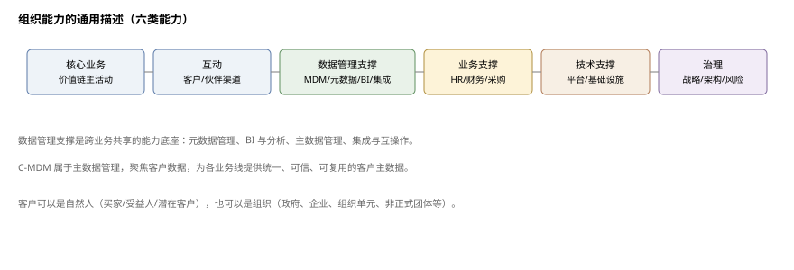
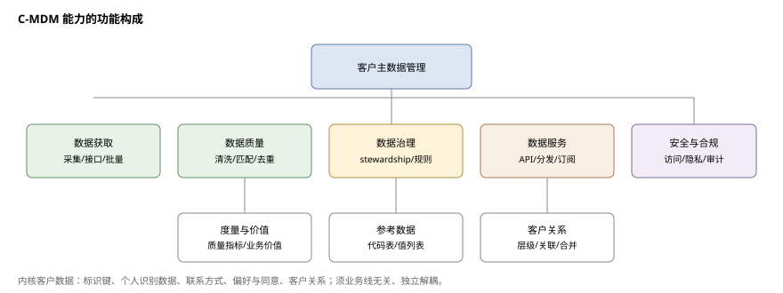
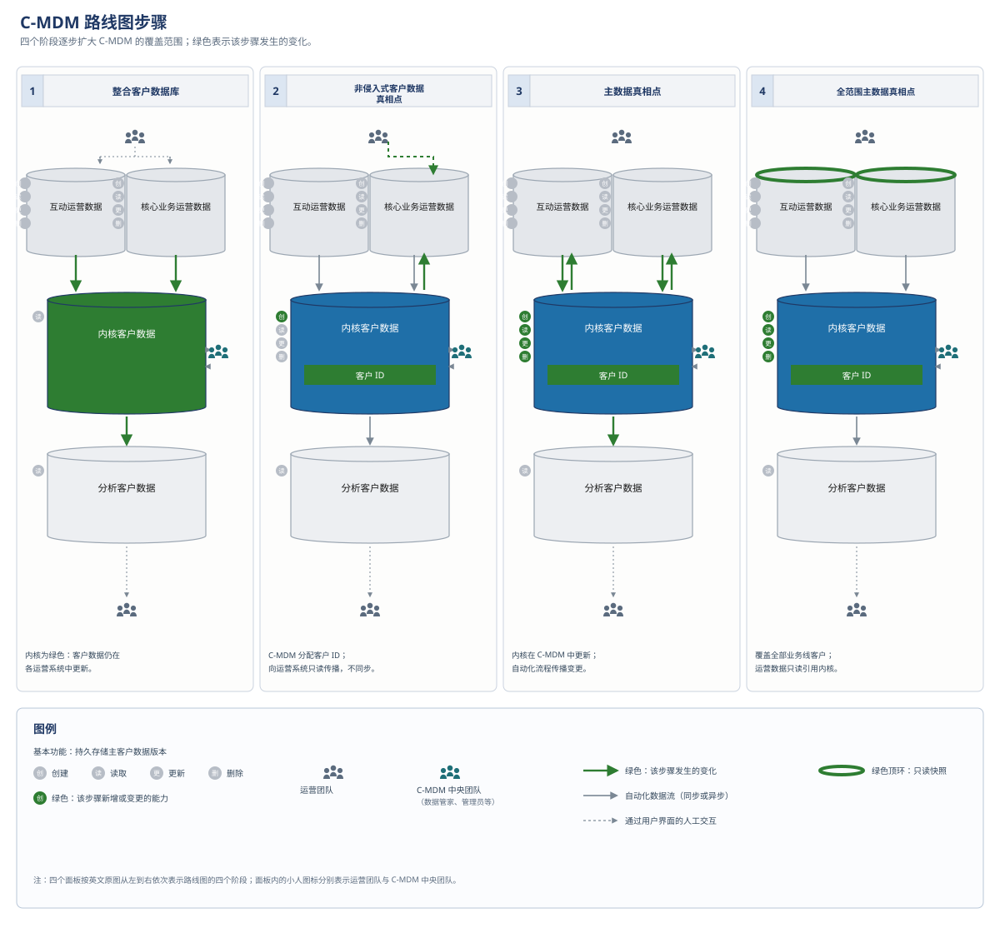
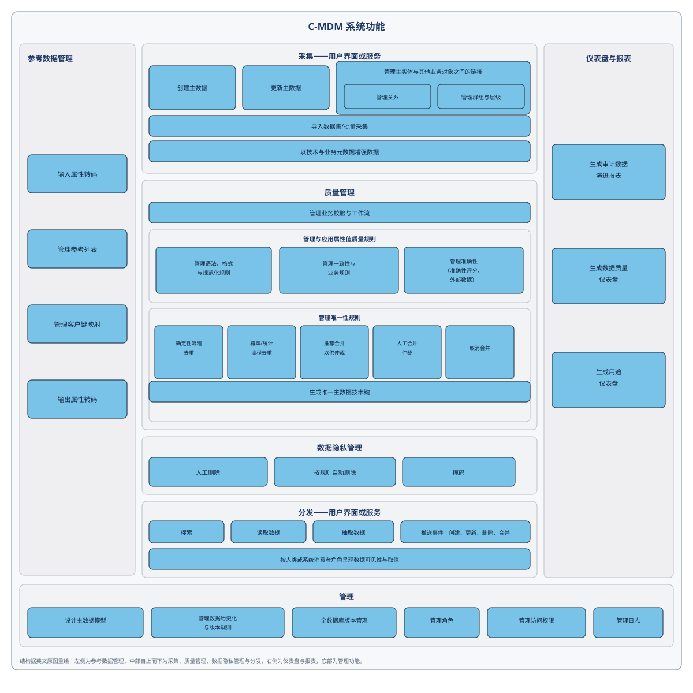
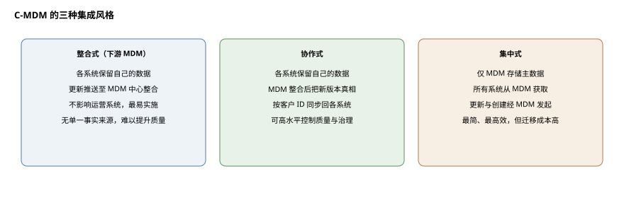
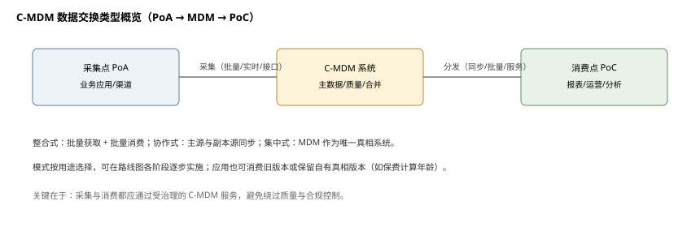

# 信息架构——客户主数据管理（C-MDM）

**The Open Group TOGAF® 系列指南**

文档编号：G21B

> 中文译本说明：本文档依据 The Open Group《Information Architecture — Customer Master Data Management (C-MDM)》（G21B）逐节翻译。术语：Customer Master Data Management=客户主数据管理；Kernel Customer Data=内核客户数据；Stewardship=数据管家（数据管护职责）。

---

## 前言

The Open Group 是一个全球性联盟，通过技术标准与开源倡议帮助各组织实现业务目标；其使命是推动实现**无边界信息流**（Boundaryless Information Flow™）。TOGAF 标准是一套经过实践检验的企业方法论与框架。本文档是 TOGAF® 系列指南之一，主题为客户主数据管理。

---

## 关于作者

（以下所属机构为文档批准时的信息。）

**AXA 数据架构社区（AXA Data Architecture Community）**

本文档受 AXA 捐赠给 The Open Group 的数据架构交付物启发。这些成果是数据架构师社区工作的结晶；2015 至 2020 年间，该社区得到（主要位于）法国、德国、比利时、英国、日本、美国、香港、西班牙、瑞士和意大利的各成员机构的贡献。该社区的宗旨是在 AXA 组织内共享数据架构最佳实践，以改进并加速架构交付。

AXA 是一家全球性保险公司（www.axa.com）。

**Céline Lescop —— 作者**

Céline 于 1996 年获得计算机科学硕士学位（www.ensiie.fr）。1999 至 2012 年，她在制药行业（Galderma 与 AstraZeneca）担任数据项目负责人；2012 至 2015 年在 Arismore（The Open Group 法国）担任架构师与 TOGAF 培训师；自 2016 年起在 AXA 担任企业架构师，领导数据架构实践。

**Jean-Baptiste Piccirillo —— 作者**

Jean-Baptiste 于 2010 年获得计算机科学硕士学位（www.ensiie.fr）。至 2015 年在 Arismore（The Open Group 法国）担任架构师；2015 至 2018 年在 AXA 担任数据科学家；目前是 Rhapsodies Conseil（www.rhapsodiesconseil.fr）的数据架构与数据管理顾问，为 AXA 提供支持。

## 致谢

（以下所属机构为文档批准时的信息。）

The Open Group 衷心感谢 The Open Group 架构论坛（Architecture Forum）过去与现在的下列成员对本文档开发的贡献：

- Julien Albert，AXA 数据转型计划负责人
- Brendon Clark，AXA 企业架构师
- Sonia Gonzalez，The Open Group
- Chris Harding，Lacibus Ltd.
- Robert Weisman，渥太华大学（University of Ottawa）

The Open Group 衷心感谢下列评审人参与本文档的公司评审（Company Review）：

- Chris Harding，Lacibus Ltd.
- Robert Weisman，渥太华大学（University of Ottawa）

## 商标

ArchiMate、TOGAF、The Open Group 等名称与标识归其各自所有者；Boundaryless Information Flow 为 The Open Group 商标。

## 参考文档

| 编号 | 文档 |
|---|---|
| [C220] | 《TOGAF® 标准》第 10 版，The Open Group 标准（C220），The Open Group 2022 年 4 月发布；参见 www.opengroup.org/library/c220 |
| [C226] | 《ArchiMate® 3.2 规范》，The Open Group 标准（C226），The Open Group 2022 年 4 月发布；参见 www.opengroup.org/library/c226 |
| [C24A] | 《The Open Group IT4IT™ 标准》3.0.1 版，The Open Group 标准，2024 年 10 月（C24A）；参见 www.opengroup.org/library/c24a |
| [DMBoK] | 《数据管理知识体系》（DMBoK）第 2 版，DAMA International；参见 www.dama.org/cpages/body-of-knowledge |
| [G176] | 《TOGAF® 系列指南：业务场景》（G176），The Open Group 2022 年 4 月发布；参见 www.opengroup.org/library/g176 |
| [G201] | 《信息架构：商业智能与分析及元数据管理参考模型》，The Open Group 指南（G201），2020 年 1 月发布；参见 www.opengroup.org/library/g201 |
| [ISO 3166-1] | ISO 3166-1:2013：国家及其下级区划名称表示代码——第 1 部分：国家代码；参见 www.iso.org/standard/63545.html |
| [ISO/TS 8000-1] | ISO/TS 8000-1:2011：数据质量——第 1 部分：概述；参见 www.iso.org/standard/50798.html |
| [The Shift Project] | 《Lean ICT：迈向数字节制》，The Shift Project，2019 年 3 月；参见 theshiftproject.org/en/article/lean-ict-our-new-report/ |
| [Porter] | Michael Porter 的价值链；参见 en.wikipedia.org/wiki/Value_chain |
| [W132] | 《信息架构愿景：从数据丰富走向信息智慧》，白皮书（W132），2013 年 4 月，The Open Group 发布；参见 www.opengroup.org/library/w132 |

---

## 1. 引言

本文档描述实施**客户主数据管理**（C‑MDM）的方法。C‑MDM 在组织中的目的是提升跨组织共享的客户信息价值，包括管理这些信息资产所需的人员、流程、组织与系统。

### 1.1 信息架构能力

自 20 世纪 80 年代组织开始投资信息系统以自动化运营以来，对信息架构的需求便已存在。最初聚焦数据建模，如今数据架构师还必须关注基于 IT 的数据管理能力——他们在组织走向成熟数据管理能力的架构中扮演关键角色。

在社会中，数字技术的使用与日俱增；同时，动态而创新的 IT 市场不断推出新方案。结果是组织信息系统持续膨胀，以多种形式存储大量数据，技术层层堆叠；另一个后果是信息系统环境影响增加，必须在未来几年内加以控制——越快越好（参见 The Shift Project 报告《Lean ICT：迈向数字节制》）。这种增长动态必须稳定下来，才能保住业务对信息系统的支持。数据管理正是能够减少数据重复与孤岛、减少存储数据量并改善业务信息获取的能力。

随着互联网与平台的兴起，数据已成为必须以财务与环境可持续方式管理的资产。数据团队与举措催生了 CDO（首席数据官）、CKO（首席知识官）等岗位，以强化 CIO 的数据管理能力，目标是交付高质量数据资产，支撑运营自动化、数据科学与个性化客户关系。许多组织正竞相实现规模化数据驱动。

信息架构实践必须专业化：以一致、整体的方式组织相关业务运营与流程、IT 系统与数据存储，同时拆分为构建块，以支持解耦但可互操作的能力。

本文档中，为支持架构而构建的信息架构工具同样适用于 C‑MDM 这一具体主题；它与处理基于 IT 的数据管理能力的其他文档互补。最佳实践来自具体项目的实战，并经过优化以适用于任何组织；目标是加速架构研究交付（不重复发明轮子、使方法敏捷）、澄清市场供给，并提供培训数据架构师及其他数据专业人员良好实践的框架；最终为 CDO、数据经理、架构师、数据工程师、数据科学家等提供共同语言。

### 1.2 数据管理能力

对多数一定规模的组织而言，价值链的主要环节已数字化，并由人工流程与信息系统支撑。图 1-1 把信息系统部门支持业务运营的能力分为六个区域，按价值链方式组织，区分支持活动与主活动。

（注：图 1-1 参考 Michael Porter 的价值链，并特别聚焦数据，以支持组织成为“数据驱动”组织。）

**内部能力**

- **支撑价值链的核心业务主活动**：包括从入站物流（如接单）到出站物流（如交付订单）、经运营（如处理订单）的支撑能力，收入在此产生。
- **互动**（Engagement）：与价值链的数字互动，包括与客户、业务用户、伙伴交互的能力，覆盖数字、服务中心、分销与伙伴渠道（B2B2C），也把 CRM、营销、服务与销售作为关键使能因素。
- **数据管理支撑**：成为数据驱动企业意味着转向数据驱动架构方法，聚焦支持业务、由 CDO 负责的数据管理能力。元数据管理、BI 与分析、主数据管理、集成与互操作是组织各业务共享的常见数据管理能力，是支撑“无边界信息流”目标的基础（见 DMBoK 第 2 版）。
- **业务支撑**：支撑价值链所需的其他支撑能力，如人力资源、财务与采购、为与 IT4IT™ 标准 [C24A] 保持一致而实施 IT 服务能力管理所需的能力、工作场所（Workplace）等。

**外部能力**

- **外部数据提供方能力**：即数据提供方，可以是开放数据，也可以是从外部获取并由组织加以利用的数据。
- **外部伙伴能力**：即市场上其他组织提供的、带数字前端（digital front）的服务；这些服务必须与本组织的数字服务相结合，才能向客户交付更完整的体验。

如图 1-2 所示，数据管理支撑能力与 DMBoK 第 2 版数据管理框架（DAMA 轮盘）中的知识领域相对应。

> 图 1-2。图内文字已中文化；原图见英文原文 Figure 1-2。

**图内标签对照**

| 图内英文 | 中文 |
|---|---|
| Data Governance | 数据治理 |
| Data Architecture | 数据架构 |
| Data Modeling & Design | 数据建模与设计 |
| Data Storage & Operations | 数据存储与运营 |
| Data Security | 数据安全 |
| Data Integration & Interoperability | 数据集成与互操作性 |
| Document & Content Management | 文档与内容管理 |
| Reference & Master Data | 参考数据与主数据 |
| Data Warehousing & Business Intelligence | 数据仓库与商业智能 |
| Metadata | 元数据 |
| Data Quality | 数据质量 |
| Metadata & data quality management | 元数据与数据质量管理 |
| BI&Analytics capability | BI 与分析能力 |
| Data integration & interoperability capability | 数据集成与互操作性能力 |
| Focus of this Guide | 本指南关注点 |

数据管理支撑能力聚焦于上述 DAMA 关键活动的一个子集，其余活动按以下方式覆盖：

- 数据安全属于更广义的“安全”能力中的业务支撑部分；
- 文档与内容管理被视为“工作场所”（Workplace）能力中的一个专门领域；
- 数据存储与运营属于“基础设施”能力——它们是支撑四项核心数据管理支撑能力的技术横向能力；
- 数据建模与设计是“IT 管理”能力的一个子集。

> **商业智能（BI）与分析**
>
> 这是一种能力：在遵守安全与隐私约束的前提下，企业的所有可用数据都能被任何经授权的用户访问。它使基于证据或事实的决策成为可能。该能力涵盖数据仓库、数据集市、BI、数据湖与数据科学等能力。这些系统将与本组织相关的所有数据（含当前值与历史值）集中在一处提供。该能力旨在向需要报表（用于监控或监管目的）、查询或更高级处理（如统计或数据科学）的利益相关者提供数据。有关该能力的指南，参见 The Open Group 指南《信息架构：商业智能与分析及元数据管理参考模型》[G201]。

> **主数据管理（MDM）**
>
> 该能力指为度量并持续提升组织的主数据与参考数据价值而组合起来的流程、组织、人员与系统。它包括业务价值、数据质量、可用性与安全性。它向需要客户数据的用例交付准确的客户数据。它确保业务价值、数据质量（一致性、准确性、语义一致性等）、可用性、安全性、数据管家职责与客户数据所有权。MDM 提供对主数据值与标识符的控制，使其能够按业务定义的数据质量要求得到一致使用。

> **主数据**
>
> 主数据是构成企业可用的最确定、最可信取值的数据，既用于共享，也用于交易、分析和/或记录目的。对于半结构化数据，它可能是经批准的企业数据生命周期策略；对于结构化数据，它可能是客户的姓名与地址。从技术上讲，主数据是一组一致的标识符与扩展属性，是企业所用共享实体的参考信息来源。主数据取值可信，企业内经授权的用户可放心使用。
>
> 历史上，以下概念先于 MDM 出现，很可能仍是新 MDM 的基础：
>
> - **记录系统（System of Record）**：由一个信息系统提供主数据，无论数据是否存放在数据库中（如平面文件）。
> - **黄金记录（Golden Record）**：由特定数据存储中的一个数据结构提供主数据。

> **参考数据**
>
> 参考数据是在企业外部定义的标准数据值，用于促进互操作，尤其是数据集成。参考数据常由标准组织定义，例如 ISO 3166-1 定义的国家代码 [ISO 3166-1]，或（供应链中的）北约库存编号。具体而言，它指仅用于对数据库中其他数据分类、或仅用于把数据库中的数据与企业边界之外的信息关联起来的任何数据。它定义了通常用于刻画、归类或分类其他数据的一组取值。

> **集成与互操作性**
>
> 该能力描述与数据在数据存储、应用和组织内部及之间的移动与整合相关的流程。它考虑数据语义（业务理解）、表示（如编码、内容展示等）与数据结构（如关系型、领域特定、XML、API）。它把数据整合为一致的形式，既可以是物理的，也可以是虚拟的。
>
> 互操作性是“合法地”共享信息与服务的能力。它聚焦于实现共享信息的能力。（来源：《TOGAF® 标准》）
>
> 支持该能力的工具包括，例如：企业服务总线（ESB）、抽取、转换、加载（ETL）与应用程序接口（API）。
>
> 更多信息参见架构论坛数据集成工作组。

> **元数据管理**
>
> 元数据是“关于数据的数据”，无论数据是非结构化的（书籍、位图图像等）、半结构化的（电子文档）还是结构化的（数据表、知识库等）。元数据描述数据本身（如创建者、语言、业务描述、安全分类、命名空间）、数据所表示的概念（如业务实体、语义、业务流程、技术方面），以及数据与其他概念之间的连接（关系）。
>
> 数据质量可视为一种特定类型的元数据，需要通过 BI 与分析进行专门监控，并对数据做全生命周期管理。其目标是设定标准、把质量构建进创建、转换与存储数据的流程，并按标准度量数据。

### 1.3 C-MDM 能力

本文档聚焦以客户数据为中心的**主数据与参考数据管理**能力。C‑MDM 是许多组织为最大化活动价值与效率必须实施的能力，是多数组织的数据基础。

确实，没有正确的数据投资，数据平台将无效。“以客户为中心”的心智意味着把客户数据作为企业级学科悉心管理。

由 C‑MDM 能力支撑的稳健数据管理组织，应通过持续度量并提升客户数据的内在价值（质量、可访问性、安全）以及由数据使用带来的实际价值（NPS、增长、效率、ROI 等），确保客户主数据及其质量受控。

在组织中，数据转型常被新概念与数据平台（数据湖、云计算、数据中枢、数据科学、大数据等）淹没；“热词”掩盖了数据转型的本质——数据本身。本文档建议：在尝试用数据科学建立高级用例之前，必须先修好数据管理的基础。

> **客户**：客户是可与组织互动的“一方”所扮演的角色。每个组织根据其业务与战略对该角色有不同定义。本文档中“客户”（client）与“customer”同义。
>
> 本文档中客户可以包括：
> - **个人**：现在存在或曾经存在的独特自然人；可与组织有多种关系——服务或产品的购买者和/或受益人；潜在客户（如向组织询价的人）。
> - **组织**：由共同目的系统联结的商业机构或群体，可具有或不具有法律地位；组织可以是法人实体。类型包括但不限于：政府（联邦、州、地区、地方及各机构）；商业机构（有限公司、上市跨国公司、子公司等）；组织单元（分支机构、部门、团队等）；非正式团体（俱乐部、协会、慈善机构、兴趣小组等）；其他类似实体。

---

## 2. 与 The Open Group 现有标准的关系

### 2.1 ArchiMate® 规范

为恰当描述 C‑MDM 架构参考模型，本文档使用 ArchiMate 建模记法 [C226]，并选用其元素子集：

**战略层**

- **能力**（Capability）：组织、人或系统等主动结构要素所拥有的能力；以通用高层术语表达，通常由组织、人员、流程、信息与技术组合实现，例如业务规划、客户管理、资产管理。

**动机方面**

- **原则**（Principle）：定义适用于架构中特定语境下任何系统之通用属性的意图陈述；是持久、极少修订的通用规则或指南，指导组织履行使命的方式；也是架构应满足的定性意图陈述。
- **利益相关者**：个人、团队或组织（或其类别）在架构影响方面利益的角色。利益相关者对组织及其企业架构有一个或多个利益或关注点。为把这些利益与关注点导向行动，利益相关者会改变、设定并强调目标；利益相关者之间也会相互影响。

**业务层**

- **业务参与者**（Business Actor）：能够执行行为的业务实体（人、组织或系统），可内部或外部。
- **业务功能**：基于选定标准（通常是所需的业务资源和/或能力）的业务行为集合，与组织紧密对齐，但不一定由组织明确治理。
- **业务对象**：特定业务域中使用的概念，对应 TOGAF 的“业务信息”。
- **业务协作**：两个或以上业务内部主动结构要素的聚合，共同执行协作行为。

**应用层**

- **应用功能**：可由应用组件执行的自动化行为。
- **应用组件**：与实现结构对齐的应用功能封装，模块化且可替换。

**实施与迁移层**

- **平台/高原**（Plateau）：在有限时间内存在的相对稳定的架构状态。

**嵌套**：本文档用嵌套作为可视化技术，表达元素间的层级或组合关系（如一个业务对象可包含一个或多个从属业务对象）。

### 2.2 TOGAF 框架扩展

本文档提出：

- 聚焦 C‑MDM，指导能力设计，包括带业务功能与应用功能描述的参考模型（见第 5 章）；
- 对 TOGAF ADM 阶段的适配，以支持 C‑MDM 转型计划的执行（见第 4 章）。

---

## 3. C-MDM 能力

对特定组织而言，C‑MDM 指为把**内核客户数据**作为资产来管理而组合起来的人员、流程、组织与系统，包括业务价值、数据质量、可用性与安全性，以向相关用例交付所需的共性客户数据。

**内核客户数据**是跨组织各部门共享的全部客户信息：

- 组织为至少确保最低客户体验所必需的客户数据（姓名、地址、客户 ID 等）；
- 组织内横向、战略性、应在价值链中共享的客户数据（客户类型、年龄、职业类别等）；
- 往往已在与组织互动语境之外存在的数据。

内核客户数据主要涉及：标识键、个人识别数据、联系方式、偏好与同意数据，以及关系数据（客户间关系、层级等）。

C‑MDM 能力由业务功能与应用功能构成。它需要组织良好的团队（业务架构）与经过适配的信息系统（信息系统架构）。C‑MDM 能力面临的挑战之一，是在自动化（数据质量、去重）与人工流程之间找到微妙的平衡——当算法无法给出确定结论时，就需要人工介入。一方面，自动化不足会产生过多的手工工作流；另一方面，算法无法解决所有数据质量问题，若缺少处理这些情形的人类智能与人力，就达不到理想的数据质量。

C‑MDM 能力由客户数据所有者高管负责，他/她将确保相关参与者作出贡献，详见图 3-1。

C‑MDM 业务功能由不同参与者负责：数据所有者或数据管家等业务参与者、数据经理，以及架构师；他们协作构建 C‑MDM 愿景并每日运营该能力。

表 3-1 给出利用该能力的高层业务功能说明。完整的详细参考模型见第 5 章。

**表 3-1：C-MDM 高层业务功能说明**

| 业务功能 | 说明 |
|---|---|
| C-MDM 能力管理与治理 | 支撑 C‑MDM 战略的业务功能：治理组织、路线图。其中包括定义客户数据所有权与数据管家职责，并确保决策在正确的位置、由相关利益相关者作出，且具备执行所需的资源（财务与人力）。 |
| C-MDM 设计 | 支撑设计任务的业务功能：数据业务规则定义、客户主数据模型设计、IT 架构设计，以及交付由该设计工作产生或所需的文档。设计活动旨在识别参与 C‑MDM 的各业务线之间可共用（mutualized）的流程。 |
| C-MDM 运营 | 支撑向客户数据的消费方与生产方交付客户主数据服务的业务功能。其目的是保持并持续改进数据质量，并确保适当的服务级别协议（SLA）水平。它运用相关方法解决数据问题，并响应围绕数据安全、合规或数据可用性与可访问性的请求。 |
| C-MDM 范围与用途扩展 | 持续支撑 C‑MDM 使用范围或数据范围扩展的业务功能。例如，集成一个新的客户数据生产方系统的过程即属于该范围。 |
| 沟通 | 与沟通相关的业务功能：在整个组织内共享与宣传 C‑MDM 团队服务、正在推进的路线图/战略以及实际成果。这些功能旨在向组织展示客户数据的价值（用例、质量等），并让所有人清楚看到：妥善管理这些数据对组织为何至关重要。 |
| 外部客户数据获取 | 业务功能必须考虑借助外部数据源增强客户数据，尤其是为加速数据质量检查与持续质量改进。 |
| 数据质量与业务价值度量 | 交付并度量数据质量、证明持续改进，并通过关键绩效指标（KPI）的定义与计算向所有相关利益相关者（包括业务与数据管理参与者）展示业务价值所需的业务功能。 |

C‑MDM 系统为客户数据提供单一真相点，并支持内核客户数据的创建、更新、删除与分发。它管理当前版本、历史版本以及合并等数据生命周期事件。

该系统位于信息系统的“中间”，与所有需要客户数据的应用互联。它参与与客户的运营互动，因此必须提供极高水平的服务质量与性能。

由于该系统与其他应用高度集成，它必须在运营上（例如停止某个客户 360（C360）服务不应导致 C‑MDM 服务停止）、维护上（更新 C360 不应影响 C‑MDM 服务，也不应要求对 C‑MDM 服务做测试）以及设计上（数据模型）与其他应用解耦，才能交付上述服务。

C‑MDM 系统还必须提供 C360 视图中与客户相关的事件数据（如合同、与组织的互动历史、理赔、与组织服务的通话等），以支撑客户数据管理。

表 3-2 给出利用该能力的高层应用功能说明。

**表 3-2：C-MDM 高层应用功能说明**

| 应用功能 | 说明 |
|---|---|
| 数据采集 | 从人工用户界面或其他系统输入（如数据流或 API）采集客户数据所需的应用功能。 |
| 数据质量管理 | 通过实施业务与技术规则、支持业务流程与校验及合并流程，确保数据质量的运营型应用功能。 |
| 数据隐私管理 | 支持数据隐私约束（如保留规则）的应用功能。 |
| 数据访问 | 客户数据消费方（人或其他系统）按可见性规则/访问权限访问“单一真相点”主数据所需的应用功能。它应提供：给定客户的当前信息；该客户变更的历史（何时、何人——手工操作时为使用者、自动处理时为应用——以及变更内容）；创建、更新、删除、去重等的单一入口。这些操作可下放到运营应用中，以适应不同业务场景（如 CRM 的离线版本）。但在这种情况下，必须对该能力加以管理。更新/创建事件必须尽快到达 C‑MDM，以避免产生会破坏主数据版本的数据重复。 |
| 参考数据管理 | 管理参考数据所需的应用功能（如稳定的类别列表、转码表）。参考数据列表是用户界面控件或质量规则执行中数据质量的关键使能因素。 |
| 质量与技术仪表盘及审计 | 监控技术与数据问题、C‑MDM 数据使用情况、数据质量，并确保可审计性所需的应用功能。 |
| 客户主数据管理 | 权限/角色管理、数据模型管理、日志管理等管理功能。 |

---

## 4. 过程与方法

### 4.1 面向 C-MDM 能力的 TOGAF ADM 适配

**表 4-1：TOGAF ADM 阶段的 C-MDM 建议**

| TOGAF ADM 阶段 | C-MDM 建议 |
|---|---|
| 预备阶段 | • 确认已具备实施该模型所需的适当企业架构能力：存储库、数据源、平台等 • 检查是否已组建具备必要技能的多学科团队，以设计有效的 C‑MDM 业务能力 • 确保架构治理良好整合，并由在组织内对数据承担横向责任的团队（如 CDO 团队、数据治理团队等）参与 • 确保所需的隐私法规与政策已具备并被理解，它们会约束 C‑MDM 的潜在应用。这对跨国客户和/或须遵守多项标准的公司尤为重要，例如《通用数据保护条例》（GDPR）、加拿大《个人信息保护与电子文件法》（PIPEDA）或美国联邦贸易委员会（FTC）隐私计划准则 |
| A——架构愿景 | • 从客户视角，以及面向客户、处理/使用客户数据的员工或业务用户视角，梳理与客户数据相关的现有痛点（可使用《TOGAF® 系列指南：业务场景》[G176] 中描述的 TOGAF 业务场景技术） • 结合现有或新的业务用途，制定 C‑MDM 的价值主张 • 高层面上执行阶段 B、C、D，以了解主要受影响系统并给出关键宏观指标（当前有多少应用可以更新内核客户数据？有多少应用可以只读方式访问内核客户数据？总体上多少用户可以更新数据？） • 创建概念性的 C‑MDM 目标架构，向关键利益相关者突出价值主张（如数据质量改进、预期收入增长、预期客户体验提升、效率、风险与合规等） • 主数据是企业内已达成一致的数据质量水平的直接函数。“准确性”“真实性”等标准元数据特征必须由业务方与数据架构师共同商定。业务方须在阶段 A 和 B 中在 SLA 合同中明确所需数据质量的性质，以确保可作为“数据即服务”获取的主数据，其成本不高于其价值。数据质量示例见 The Open Group 白皮书《信息架构愿景》附录 A、DMBoK 第 2 版，以及最新版 ISO 8000：ISO/TS 8000-1:2011 [ISO/TS 8000-1] |
| B——业务架构 | • 业务方对数据质量负有问责与责任。建立确保主数据质量得以达成并持续的必要治理、流程与资源 • 理解客户数据在业务日常活动中的使用情况 • 识别与客户数据相关的运营问题与相关故事，并理解深层原因：组织、流程与工具、人员或技术方面 • 识别当前因数据质量不足而效率不高的运营或活动。识别 C‑MDM 应支持的未来用例（如准确的 C360 视图、同意管理、有效的多渠道营销等） • 维护用例待办与问题待办，为 C‑MDM 计划提供输入 • 形式化 C‑MDM 为发展这些用例或纠正当前数据问题应覆盖的新需求 • 形式化围绕内核客户数据管理的现有组织 • 提出目标组织与流程，以增强 C‑MDM 并帮助覆盖新识别的需求 • 特别要从业务架构角度描述匹配与合并（match-and-merge）的目标流程 • 识别变革工作量水平，并调动适当资源以推行目标组织与流程 |
| C——信息系统架构 | • 全面了解当前创建、读取、更新和/或删除客户主数据的现状应用 • 就客户数据维度对每个应用作出界定（涉及客户数量、客户主数据创建/更新的频率、用于评估数据源现有质量的数据画像、业务价值） • 就现有或规划中的项目或演进/路线图，对每个应用作出界定（例如，这可能是把主控权迁移到未来 C‑MDM 的机会） • 识别当前信息系统架构中的问题与改进点 • 定义逻辑目标信息系统架构，以一致地管理内核客户数据 • 评审客户匹配与合并流程 |
| D——技术架构 | 检查技术选择能否围绕内核客户数据支撑一致的事务处理（系统旨在成为该数据的真相点）。这些能力应与 IT 景观松耦合，以确保关键事务的一致性与可用性，并便于高效维护。 |
| E——机会与解决方案 | 使用本文档中的应用参考模型来质询 C‑MDM 解决方案提供商。参考模型可作为制定解决方案选择标准的基础。 |
| F——迁移规划 | • 完整掌握与 C‑MDM 主题相邻的规划项目/举措（如与客户数据管理应用相关的项目），界定依赖关系与潜在机会 • 利用（阶段 C 中的）应用界定结果，随时间推进集成优先级排序（如考虑业务价值、客户数量与当前质量、复杂度），并研究现有举措与规划项目能否用于覆盖 C‑MDM 计划的演进 • 定义迁移路线图，并说明内核客户数据的主控能力如何沿该路线图演进 |
| G——实施治理 | 组织对 C‑MDM 项目的合规性审查，检查其是否遵循 C‑MDM 原则与目标架构。（原则示例见 4.3 节。） |

### 4.2 架构愿景阶段的 C-MDM 指南

C-MDM 项目复杂，会影响整个实体的范围，涉及众多参与者。因此，必须首先建立愿景，并在高层面上与所有相关利益相关者达成共识。表 4-2 给出该愿景的各个维度。该愿景必须由执行发起人和/或 CEO 认可。

**表 4-2：架构愿景的维度**

| 维度 | 从（FROM） | 到（TO） | 关键举措 |
|---|---|---|---|
| C-MDM 团队 | 部分数据规则未形成文档 | 由一个 C-MDM 团队对客户数据负责 | 组建一支多能型 C-MDM 团队，赋予其治理与决策权；定义并运行所有权与数据管家职责，使业务方认识到其在数据及数据质量方面的（新）责任；定义团队的增值服务目录及明确的 SLA |
| 单一可信真相源系统（Single point of reputed truth system） | 多个潜在的真相点 | 客户数据的单一真相源 | 为内核客户数据设定雄心勃勃且各方共享的单一真相源目标；保持机会主义——对信息系统有清晰愿景，在相关或可能时把 C-MDM 集成进已规划的项目方案；在 C-MDM 计划的早期步骤中注意向运营流程交付业务价值——数据质量交付必须解决业务问题（如信件、电子邮件无法送达，客户同意未被正确管理等）；C-MDM 应保存客户数据的所有实例，而不仅是当前主版本——某些业务用途可能需要它们；例如出生日期常用于定价，若保费按错误日期计算，错误日期也应保留 |
| 数据质量与信任度量 | 对客户数据质量与合规性存疑 | 信任与准确性得到持续度量与改进 | 持续度量数据质量与业务价值（KPI、ROI），鼓励业务方定义质量仪表盘与业务 KPI；利用外部数据、文档与证据提升质量（如身份证、外部数据供应商的数据源）；确保 C-MDM 提升满足风险与监管要求的能力 |
| 业务正向影响得到保障，从付费方到伙伴 | 难以对客户做出被动响应与主动响应 | 真正的伙伴关系与相互信任 | 优先关注最贴近客户的系统与人员（即互动/Engagement），使其得到良好服务；持续了解运营与战略层面的业务演进——这可能改变项目优先级；预见把可运营、可用的 C360 视图及其他增值服务纳入 C-MDM 方法的机会 |

该愿景应涵盖关键 C-MDM 利益相关者（原文 Figure 4-1：架构愿景的利益相关者）。

> 图 4-1。图内文字已中文化；原图见英文原文 Figure 4-1。

**图内标签对照**

| 图内英文 | 中文 |
|---|---|
| External | 外部 |
| Operational Management and Team | 运营管理与团队 |
| High-Level Management and Sponsorship | 高层管理与赞助 |
| Customer | 客户 |
| Regulator | 监管机构 |
| External Data Provider | 外部数据提供方 |
| Business Partners | 业务伙伴 |
| Distributors / Agent (Customer-Facing Employees Capturing Customer Data / Requests) | 分销商/代理（面向客户、负责采集客户数据/请求的员工） |
| C-MDM Operational Team (including IT, Architects, Data and Business Actors) | C-MDM 运营团队（含 IT、架构师、数据与业务参与者） |
| Customer Data Owner | 客户数据所有者 |
| C-MDM Product Owner | C-MDM 产品负责人 |
| Chief Data Officer (CDO) | 首席数据官（CDO） |
| Chief Technology Officer (CTO) | 首席技术官（CTO） |
| Human Resources/Change Leader | 人力资源/变革负责人 |
| Business Process Owners | 业务流程所有者 |
| Chief Executive Officer (CEO) | 首席执行官（CEO） |

最后，C-MDM 方法必须具备横向（跨部门）愿景；最佳的执行发起人是能够为客户利益打破组织/业务线孤岛的 CEO。

### 4.3 C-MDM 架构原则

以下为建立 C‑MDM 能力时常见的架构原则，按 TOGAF ADM 的结构呈现，先业务原则，再数据原则，最后应用原则。这些原则既可作为首个清单按组织调整，也可与现有 C‑MDM 原则清单比对。它们是首个可复用的版本，应补充“理由”与“影响”以完整形式化。

#### 4.3.1 业务原则

**表 4-3：业务原则**

| 编号 | 原则陈述 |
|---|---|
| P_BUSINESS_001 | 指定 C‑MDM 团队并对客户数据负责；该团队有权决定客户数据相关事项（如合并规则与流程、数据管家、所有权），并与业务及 IT 利益相关者组织专门治理。 |
| P_BUSINESS_002 | C‑MDM 能力在业务范围与信息系统中的中心性，要求具备多领域的高层知识与专长：业务线、IT、数据管理；这些技能必须由 C‑MDM 团队覆盖。 |
| P_BUSINESS_003 | 应存在 C‑MDM 团队定义良好的增值服务目录及相关 SLA。 |
| P_BUSINESS_004 | C‑MDM 团队应明确把外部数据视为改进去重与数据质量服务的潜在杠杆，并定期开展外部数据市场分析。 |
| P_BUSINESS_005 | C‑MDM 团队应在可能时鼓励在数据管家流程中使用文档与证据（如身份证、账单等）以改进数据质量。 |
| P_BUSINESS_006 | 客户数据质量指标由 C‑MDM 团队定义、生成并共享。 |
| P_BUSINESS_007 | C‑MDM 能力业务价值指标由 C‑MDM 团队定义、生成并共享。 |

#### 4.3.2 数据原则

**表 4-4：数据原则**

| 编号 | 原则陈述 |
|---|---|
| P_DATA_001 | 应定义目标 C‑MDM 数据业务范围（业务线、客户角色等）。 |
| P_DATA_002 | 必须识别一组可唯一标识每个客户的字段，并通过 C‑MDM 能力管理，称为内核客户数据；该字段集的质量必须是 C‑MDM 团队的首要关注。 |
| P_DATA_003 | 每个被识别的唯一客户都应有技术键；技术键与客户业务键之间的链接应在 C‑MDM 能力中管理。 |
| P_DATA_004 | 内核客户数据应与业务线无关，并与其他客户数据解耦，以保证高可用性、稳定性、性能与可扩展性。 |
| P_DATA_005 | C‑MDM 能力应提供客户数据的最新版本，并跟踪历史版本与操作，包括来源、作者、日期等上下文元数据。 |
| P_DATA_006 | 客户主数据模型必须包含以下概念实体：客户数据属性、客户关系、客户角色。 |
| P_DATA_007 | 客户数据必须有文档：数据字典、术语表、模型。 |
| P_DATA_008 | C‑MDM 访问必须符合实体要求与当地法规。 |
| P_DATA_009 | C‑MDM 不是合同/保单数据的主者，也不会把任何“真相”强加于合同数据；合同数据是改进客户数据质量的输入，客户数据也是改进合同数据质量的输入；合同管理流程决定其活动使用哪些数据，C‑MDM 流程决定其活动使用哪些数据。 |

#### 4.3.3 应用原则

**表 4-5：应用原则**

| 编号 | 原则陈述 |
|---|---|
| P_APPLICATION_001 | 应用架构通过与采集点和消费点的一致集成来支持 C‑MDM 能力；该集成确保客户数据的一致性与完整性，并可访问客户数据的所有实例（当前或旧版本）。 |
| P_APPLICATION_002 | 集成模式应定义良好、文档完备并可用，以支持与 C‑MDM 系统的数据交换。 |
| P_APPLICATION_003 | 应用架构应符合组织的安全规则。 |
| P_APPLICATION_004 | 应实现一个或多个用户界面以支持客户主数据功能（数据管家）；视数据管家安排，界面可位于运营系统或专门的 C‑MDM 界面。 |
| P_APPLICATION_005 | 应用架构必须提供：支持客户数据事务（创建、更新、合并、删除等）的操作能力；支持潜在复杂去重流程、质量指标与评分的分析能力。 |
| P_APPLICATION_006 | 系统应围绕内核 C‑MDM 具备松耦合能力，以确保主数据范围的数据一致性、可用性、可访问性与稳定性。 |

### 4.4 参考 C-MDM 路线图步骤（ADM 阶段 F）

本节提出参考 C-MDM 路线图步骤，用于支撑架构旅程，并可用于组织 TOGAF ADM 阶段 F：迁移规划。原文图 4-2 给出这些步骤（plateau，阶段）的示意，表 4-6 逐项说明。

> 图 4-2：C-MDM 路线图步骤（plateau）。图内文字已中文化；结构据英文原图重绘。

**表 4-6：C-MDM 路线图步骤（plateau）**

| 步骤（plateau） | 说明 |
|---|---|
| 步骤 1：整合客户数据库（Consolidated Customer Database） | 集中式客户数据存储，但尚无真正的黄金记录（去重无效、数据质量差）。 • 内核客户数据在不同运营系统中更新 • 这些内核数据被整合到 C-MDM 的初始版本中，作为客户黄金记录的第一版 **用例：** • 该首版可支持细分、市场份额分析、C360 视图、部分活动管理等用例；这些用例可容忍匹配过程中的错误（去重不要求 100% 准确） **数据质量：** • 执行匹配算法以评估客户重复率 • 构建客户数据质量仪表盘，共享客户数据质量洞察：完整性、唯一性、一致性等 **进入下一步的触发条件：** • 需要提升数据质量并支持面向客户的业务流程 （注：客户的“黄金记录”是指组织认定为真相的客户数据值，即使其他系统中可能存在该数据的其他版本。） |
| 步骤 2：非侵入式客户数据真相点（Non-intrusive Customer Data Point of Truth） | 以黄金记录、去重与数据质量改进为核心的分析型 C-MDM。 • 内核数据仍在不同运营系统中更新 • C-MDM 为每个已识别的唯一个人提供黄金记录，并分配稳定的组织客户 ID；该黄金记录可传播到运营系统，但不同步 • 专职的中央 C-MDM 团队负责数据管家工作，包括确认去重、分析数据质量问题、数据纠正与补全 **用例：** • 应对互动类用例：向 CRM 系统发送新地址或错误地址检测的自动告警，向座席展示黄金记录 **数据质量：** • 借助中央 C-MDM 团队的人工反馈闭环，部分数据质量问题在运营源系统中得到根因解决 • 数据质量提升 **进入下一步的触发条件：** • 并发更新带来工作量，进而产生更强集成需求；共享客户数据的价值对业务线显而易见，从而获得赞助，以对信息系统产生更大影响 |
| 步骤 3：主数据真相点（Master Point of Truth） | 运营型 C-MDM，逐步扩展其在信息系统中的主控范围。 • 内核客户数据在 C-MDM 中更新（通过不同集成模式：服务、实时同步、用户界面等） • 自动化流程/工作流传播数据变更 **用例：** • 指标准确，如客户数量 • 审视核心业务或互动中的运营业务流程与应用，以利用客户黄金记录；从而实现跨渠道一致的客户体验 • 客户数据质量成为业务伙伴关系中的竞争优势，并支持高级客户服务 **数据质量：** • 数据质量达到预期目标水平——高集成伴随高数据质量要求：一次错误的合并可能引发危机 **进入下一步的触发条件：** • 持续沟通 C-MDM 价值，以确保多年赞助——运营系统逐个集成，客户数据范围随之扩大 |
| C-MDM 目标（C-MDM Target） | 覆盖整个信息系统的运营型 C-MDM。 • 客户数据治理与数据管家制度化 • C-MDM 覆盖业务线客户群体的完整范围：个人、商业客户等 • C-MDM 是信息系统的核心组成部分；其价值已得到验证 |

---

## 5. 参考模型

参考模型旨在成为稳定且通用的语言，用于描述平台应覆盖的功能。它们可用于：

- 描述某一供应商的功能覆盖范围，或比较两家供应商的功能覆盖范围；
- 从业务与技术两个角度评估特定组织的基线（现状）架构；
- 设计特定组织的目标（未来）架构与过渡架构；
- 评估某一能力的成熟度；
- 在架构治理中，就目标架构的场景作出决策。

本章提供两类参考模型：

- 内核客户数据范围参考模型；
- C‑MDM 详细业务功能与应用功能参考模型。

### 5.1 C-MDM 内核客户数据范围

如前所述，内核客户数据范围包含关于客户的横向（跨部门）数据。本节给出一份最常见的、被视为内核数据的字段清单，覆盖自然人内核数据与组织/法人内核数据。它不应被当作强制性指南，而应作为初始基线，或作为核对清单，与特定组织中的计划或现有能力作对比。

#### 5.1.1 自然人内核数据

> 图 5-1。图内文字已中文化；原图见英文原文 Figure 5-1。

**图内标签对照**

| 图内英文 | 中文 |
|---|---|
| Customer Data – Physical Person | 客户数据——自然人 |
| Internal Identification Keys | 内部标识键 |
| External Identification Keys | 外部标识键 |
| Personal Identification Data | 个人标识数据 |
| Contact Data | 联系方式数据 |
| Preferences/Consent Data | 偏好/同意数据 |
| Relationships with Other Customers | 与其他客户的关系 |

**表 5-1：自然人内核数据**

| 数据类型 | 信息项 | 说明（如需） |
|---|---|---|
| 内部标识键 | 内部业务键（客户编码） | 对业务和对客户都有意义的客户编码/键。 |
| 内部标识键 | 唯一内部技术键（客户键） | 由 C-MDM 管理的客户唯一内部技术键。 |
| 内部标识键 | 由 C-MDM 之外的应用管理的其他唯一技术键 | 由其他应用（CRM 等）管理的客户唯一内部技术键。 |
| 外部标识键 | 外部键（如身份证号、该自然人的外部数据供应商参考号等）。组织必须核实其被允许存储和处理此类信息。 | 外部键可用于确保客户的唯一性（如身份证号）；它们还支持与外部数据供应商协作以改进数据质量。 |
| 个人识别数据 | 名 | — |
| 个人识别数据 | 姓 | — |
| 个人识别数据 | 出生日期 | — |
| 个人识别数据 | 出生地 | — |
| 个人识别数据 | 家庭/婚姻状况 | — |
| 个人识别数据 | 官方职业类别 | — |
| 联系方式数据 | 地址 | — |
| 联系方式数据 | 电子邮箱 | — |
| 联系方式数据 | 电话号码 | — |
| 联系方式数据 | （其他联系方式：社交网络等） | — |
| 偏好/同意数据 | 客户授权或不授权组织为既定目的使用某一范围客户数据的 opt-in/opt-out 状态 | 在许多组织中，该字段是在 C-MDM 中引入的，并按 GDPR 于 2018 年生效的要求加以管理。 |
| 与其他客户的关系 | 属于某一群体的其他个人之间的关系 | 例如父亲、母亲、子女、员工等。 |

#### 5.1.2 组织/法人内核数据

组织多数情况下是依所在国家规定在主管机关登记的法人实体，可以是公司、行政机构、非政府组织（NGO）等。

> 图 5-2。图内文字已中文化；原图见英文原文 Figure 5-2。

**图内标签对照**

| 图内英文 | 中文 |
|---|---|
| Customer Data – Organization | 客户数据——组织 |
| Internal Identification Keys | 内部标识键 |
| External Identification Keys | 外部标识键 |
| Legal Person Description | 法人描述 |
| Contact Data | 联系方式数据 |
| Preferences/Consent Data | 偏好/同意数据 |
| Relationships/Group Membership | 关系/集团成员 |

**表 5-2：组织/法人内核数据**

| 数据类型 | 信息项 | 说明（如需） |
|---|---|---|
| 内部标识键 | 内部业务键（客户编码） | 对业务和对客户都有意义的客户编码/键。 |
| 内部标识键 | 唯一内部技术键（客户键） | 客户的唯一内部技术键。 |
| 外部标识键 | 外部键（如组织官方编号、该组织的数据供应商参考号、国家登记 ID 等） | 外部键可用于确保客户的唯一性；它们还支持与外部数据供应商协作以改进数据质量。对法人而言，注册通常伴随一个公共 ID。 |
| 法人描述 | 名称（原文 *First name*） | 组织的官方名称。 |
| 法人描述 | 替代名称 | 对业务有意义的潜在替代名称，即使用名称。 |
| 法人描述 | 出生日期（原文 *Date of birth*） | 组织的成立日期。 |
| 法人描述 | 关于组织的规模参数数据（dimensioning data） | 例如用于界定组织权重的官方类别。 |
| 法人描述 | 组织业务领域 | 例如该国使用的官方业务领域名称。 |
| 联系方式数据 | 相关自然人及其联系方式 | 可以是对 C-MDM 中另一自然人的链接。 |
| 联系方式数据 | 相关地址 | 用于与该组织通信的相关地址。 |
| 联系方式数据 | 相关电子邮箱 | 用于与该组织通信的相关电子邮箱。 |
| 联系方式数据 | 相关电话号码 | 用于与该组织通信的相关电话号码。 |
| 关系/集团成员 | 与其他个人的关系（如与该组织相关的重要自然人、CEO 等），以及属于某一群体（如集团总部与关联公司）的关系 | — |

### 5.2 C-MDM 详细功能参考模型

本节以更详细的业务功能与应用功能，补全第 3 章给出的参考模型。它可用于：在架构研究中深入探讨特定问题、评估现有能力的成熟度，或为待定制的 C-MDM 项目提供第一版框架。

#### 5.2.1 详细业务功能（按原文表 5-3）

> 图 5-3。图内文字已中文化；原图见英文原文 Figure 5-3。

**图内标签对照**

| 图内英文 | 中文 |
|---|---|
| Customer-MDM Team | 客户主数据管理团队 |
| Data Manager | 数据经理 |
| Business Data Owner | 业务数据所有者 |
| Data Steward | 数据管家 |
| Architect | 架构师 |
| C-MDM Capabilities Management and Governance | C-MDM 能力管理与治理 |
| Define C-MDM Objectives and Roadmaps | 定义 C-MDM 目标与路线图 |
| Define and Onboard Data Owners and Data Stewards | 定义并吸纳数据所有者与数据管家 |
| Define and Operate Data Governance Principles | 定义并运行数据治理原则 |
| Coordinate Decision-Making and Prioritization | 协调决策与优先级 |
| Define Team Services and Operate SLAs | 定义团队服务并运营 SLA |
| External Data Acquisition | 外部客户数据获取 |
| Analyze the Data Market and Identify Opportunities | 分析数据市场并识别机会 |
| Set Up a Date Partnership | 建立数据伙伴关系 |
| Purchase External Customer Data | 采购外部客户数据 |
| C-MDM Design | C-MDM 设计 |
| Design Customer Data Models | 设计客户数据模型 |
| Design C-MDM Architecture Principles and Ensure Consistency of Data Solutions | 设计 C-MDM 架构原则并确保数据方案一致性 |
| Formalize Customer Master Data Validation Workflows, Quality, and Business Rules | 形式化客户主数据校验工作流、质量与业务规则 |
| Define and Operate Data Access Model | 定义并运行数据访问模型 |
| Define, Maintain, and Share Customer Data Documentations (Data Dictionaries, Glossaries, Models) | 定义、维护并共享客户数据文档（数据字典、术语表、模型） |
| Define, Follow, and Monitor Data Retention Rules | 定义、遵循并监控数据保留规则 |
| C-MDM Operation | C-MDM 运营 |
| Receive and Manage Requests about Customer Data (GDPR, etc.) | 接收并管理客户数据相关请求（GDPR 等） |
| Assess and Manage Master Customer Data Quality Issues | 评估并管理客户主数据质量问题 |
| Correct Data Issues | 纠正数据问题 |
| Validate Customer Merges | 校验客户合并 |
| Extension of C-MDM Scope and Usages | C-MDM 范围与用途扩展 |
| Data Quality and Business Value Measurement | 数据质量与业务价值度量 |
| Communication | 沟通 |

各项业务功能的详细说明见下文表 5-3（按原文 A–G 七组给出）。

**A. C-MDM 能力管理与治理**

| 业务功能 | 说明 |
|---|---|
| 定义 C-MDM 目标与路线图 | 定义 C-MDM 能力的转型步骤，明确各步骤目标及实现计划。 |
| 定义并吸纳数据所有者与数据管家 | 在常态化运营（BAU）中识别并吸纳业务数据所有者，聚焦内核客户数据。 |
| 定义并运行数据治理原则 | 定义客户主数据的数据治理原则，并建立组织与机构（如委员会）运行这些原则。 |
| 协调决策与优先级 | 建立并运转数据治理委员会，确保 C-MDM 路线图在实体内有效实施，保证客户数据决策一致，并评审关键仲裁。 |
| 定义团队服务并运营 SLA | 定义 C-MDM 团队服务目录、潜在用户与服务接口（工单工具、电话、集中邮箱等），为每项服务定义并遵守 SLA。 |

**B. C-MDM 设计**

| 业务功能 | 说明 |
|---|---|
| 设计客户数据模型 | 设计并记录客户主数据模型（信息模型、数据库模型、属性定义与类型等）。 |
| 设计 C-MDM 架构原则并确保数据方案一致性 | 定义客户主数据需求（存储、传输、发布、转换、归档、元数据、质量、主/参考数据管理等）并符合合规标准；定义数据架构框架；参与 IT 路线图与投资评估；确保关键数据符合合规与安全标准。 |
| 支持客户数据管理实施 | 提供资源，确保 C-MDM 系统与团队持续满足要求；按路线图分步实施。 |
| 形式化客户主数据校验工作流、质量与业务规则 | 形式化业务规则与数据管家工作流，保证既有数据质量提升，并确保新数据更新流程设计合理。 |
| 帮助业务调整流程以确保数据质量 | 在纳入新数据范围或新用例时，帮助业务调整受影响流程；变革管理投入不可低估。 |
| 定义并运行数据访问模型 | 按安全、隐私/合规与价值分类定义数据访问画像，并通过 C-MDM 运行这些访问模型。 |
| 定义、维护并共享客户数据文档 | 在共享存储库中维护与主数据对象相关的规则；维护数据字典与术语表；资本化并共享信息与数据模型；记录消费点、采集点与数据流；记录数据管家流程（谁在何时、如何对客户数据负责）。 |
| 定义、遵循并监控数据保留规则 | 保留规则是数据生命周期的一部分，明确各类数据的保留期限（因隐私删除或因税务保留）。 |

**C. C-MDM 运营**

| 业务功能 | 说明 |
|---|---|
| 接收并管理客户数据相关请求（GDPR 等） | 接收所服务业务方提出的请求（如经纪人/代理提出的数据更正请求、客户关于其数据的请求、运营服务上报的质量问题），并将其路由给正确的人员/数据管家。 |
| 评估并管理客户主数据质量问题 | 检测并管理数据质量问题，属于 MDM 运营的一部分（区别于质量度量）。 |
| 纠正数据问题 | 恢复真相并据此更新数据。 |
| 校验客户合并 | 人工仲裁两个客户的合并：核验这两个客户，使其成为同一个人并最终合并。 |
| 确保运营业务流程获得适当的 C-MDM 数据与服务 | 确保运营业务用户（消费者或生产者）拥有适当的界面，以最优方式支撑其流程；了解业务需求与痛点。 |

**D. C-MDM 范围与用途扩展（Extension of C-MDM Scope and Usages）**

| 业务功能 | 说明 |
|---|---|
| 支持数据生产方应用的新集成 | 该活动属于常态化运营（BAU）。对数据生产方应用新集成的支持方式管理良好，以新客户群体可持续扩展 C-MDM 范围的流程已得到掌控。 |
| 支持数据消费方应用的新集成 | 该活动属于常态化运营（BAU）。对数据消费方应用新集成的支持方式管理良好；新的数据消费有清晰定义的用例作为语境。 |
| 支持新的外部数据源集成 | 该活动属于常态化运营（BAU）。在 C-MDM 生态中集成新外部数据源的方式管理良好。 |

**E. 沟通（Communication）**

| 业务功能 | 说明 |
|---|---|
| 沟通 C-MDM 价值与当前用途 | 就用 KPI 沟通 C-MDM 能力的价值（降低成本/复杂度、带来的定性/定量收益、客户数据使用者的满意度评分等）。 |
| 沟通客户数据团队服务目录 | 向这些服务的潜在内部用户沟通客户数据团队的服务目录。 |
| 沟通客户数据质量 | 向运营或高层利益相关者沟通质量仪表盘。 |

**F. 数据质量与业务价值度量（Data Quality and Business Value Measurement）**

| 业务功能 | 说明 |
|---|---|
| 构建并交付客户数据质量与演进的报告 | 与高管、业务方、业务数据所有者及数据管家共同设计质量仪表盘，并按他们的要求实现质量仪表盘。 |
| 报告 C-MDM 业务价值 | 与业务方（包括 IT 团队）共同识别并实施相关的 KPI。 |

**G. 外部客户数据获取（External Customer Data Acquisition）**

| 业务功能 | 说明 |
|---|---|
| 分析数据市场并识别机会 | 分析围绕提供参与方/联系人数据的市场（潜在伙伴或数据供应商）；管理并转化这些机会，以发展改进客户数据质量的新方式。 |
| 建立数据伙伴关系 | 建立伙伴关系，或将现有伙伴关系扩展到某种数据交换，以借助这些外部数据源改进数据质量；随时间在运营层面管理数据伙伴关系。 |
| 采购外部客户数据 | 统一管理联系人/参与方数据的采购，并把此外部数据集成到客户数据管理流程中。 |

#### 5.2.2 详细应用功能（按原文表 5-4）

> 图 5-4：C-MDM 系统功能。图内文字已中文化；结构据英文原图重绘。

**图内标签对照**

| 图内英文 | 中文 |
|---|---|
| C-MDM System Functions | C-MDM 系统功能 |
| Reference Data Management | 参考数据管理 |
| Input Attributes Transcodification | 输入属性转码 |
| Manage Reference List | 管理参考列表 |
| Manage Customer Key Mapping | 管理客户键映射 |
| Output Attributes Transcodification | 输出属性转码 |
| Acquisition – User Interface or Services | 采集——用户界面或服务 |
| Create Master Data | 创建主数据 |
| Update Master Data | 更新主数据 |
| Manage Links Between Master Entities and Other Business Objects | 管理主实体与其他业务对象之间的链接 |
| Import Data Set, Mass Acquisition | 导入数据集/批量采集 |
| Quality Management | 质量管理 |
| Manage Business Validation & Workflows | 管理业务校验与工作流 |
| Manage & Apply Attribute Value Quality Rules | 管理与应用属性值质量规则 |
| Manage Uniqueness Rules | 管理唯一性规则 |
| De-duplicate with Determinist Process | 确定性流程去重 |
| Recommend Merges to Arbitrate | 推荐合并以供仲裁 |
| Unmerge | 取消合并 |
| Generate Unique Master Technical Key | 生成唯一主数据技术键 |
| Data Privacy Management | 数据隐私管理 |
| Manual Deletion | 人工删除 |
| Automated Deletion with Rules | 按规则自动删除 |
| Masking | 掩码 |
| Distribution – User Interface or Service | 分发——用户界面或服务 |
| Search | 搜索 |
| Push Events: Create, Update, Delete, Merge | 推送事件：创建、更新、删除、合并 |
| Dashboards & Reports | 仪表盘与报表 |
| Generate Audit Data Evolution Reports | 生成审计数据演进报表 |
| Administration | 管理 |
| Manage Access Rights | 管理访问权限 |

各项应用功能的详细说明见下文表 5-4（按原文七组给出，逐项列出功能名与说明）。

**A. 采集——用户界面或服务（Acquisition – User Interface or Services）**

| 应用功能 | 说明 |
|---|---|
| 创建主数据（Create Master Data） | 创建新的客户主记录，并分配唯一的内部组织键。 |
| 更新主数据（Update Master Data） | 更新已有的客户主记录。 |
| 管理主实体与其他业务对象之间的链接（Manage Links between Master Entities and Other Business Objects） | 创建、更新和删除参与方之间的链接，以及参与方与其他对象（如合同、报价中的角色等）之间的链接——这些对象在 C-MDM 中作为副本管理。删除操作必须谨慎执行，以免破坏完整性或产生孤立记录。 |
| 导入数据集/批量采集（Import Data Set, Mass Acquisition） | 对多个参与方进行数据采集（计划批处理集成，或通过用户界面人工采集等）。 |
| 以技术与业务元数据增强数据（尤其是数据血缘）（Enhance Data with Technical and Business Metadata） | 数据集成时管理元数据，如客户数据实例的版本、更新/创建的来源、最后更新日期。 |

**B. 质量管理（Quality Management）**

| 应用功能 | 说明 |
|---|---|
| 管理业务校验与工作流（Manage Business Validation and Workflows） | 在相关时提供支持主数据校验流程的功能。 |
| 管理与应用属性值质量规则（Manage & Apply Attribute Value Quality Rules） | 增加、更新和删除属性值规则，以确保质量，并发现格式、一致性与业务问题。 |
| 管理语法、格式与规范化规则（Manage Syntax, Format, Normalization Rules） | 管理格式校验，并设置规范化规则（如基于规范化代码/类别列表）或标准化规则（基于标准格式）。 |
| 管理一致性与业务规则（Manage Consistency and Business Rules） | 管理一致性规则（如两个属性值之间的一致性）与业务规则。 |
| 管理准确性（Manage Accuracy） | 管理准确性水平/置信度评分（如基于与外部数据源的比较）。 |
| 管理唯一性规则（Manage Uniqueness Rules） | 用于检测重复、并提出最佳去重方式的一组功能。 |
| 确定性流程去重（De-duplicate with Determinist Process） | 通过设计好的、带规则的自动化工作流去重。 |
| 概率/统计流程去重（De-duplicate with Probabilist/Statistic Process） | 基于纯统计比较去重。 |
| 推荐合并以供仲裁（匹配）（Recommend Merges to Arbitrate） | 基于确定性或统计流程，系统推荐潜在的合并供仲裁（非 100% 置信）。 |
| 人工合并仲裁（Manual Merge Arbitrage） | 合并决定由授权人员通过用户界面确认。 |
| 取消合并（Unmerge） | 支持人工取消合并。 |
| 生成唯一主数据技术键（Generate Unique Master Technical Key） | 管理唯一技术键的分配。 |

**C. 数据隐私管理（Data Privacy Management）**

| 应用功能 | 说明 |
|---|---|
| 人工删除（Manual Deletion） | 人工搜索并删除数据（该功能的可访问性应受到严格限制）。 |
| 按规则自动删除（Automated Deletion with Rules） | 基于既定规则自动删除，或提出删除建议。 |
| 掩码（Masking） | 按隐私要求对数据作掩码处理。 |

**D. 分发——用户界面或服务（Distribution – User Interface or Service）**

| 应用功能 | 说明 |
|---|---|
| 搜索（Search） | 按不同条件搜索个人。条件可基于属性（如业务键、名、姓、联系方式等），也可基于相关对象属性（如保单号、理赔号等）。 |
| 读取数据（Read Data） | 读取给定个人的数据值。 |
| 提取数据（Extract Data） | 按批或人工提取某一范围个人的数据值（如基于筛选条件）。 |
| 推送事件（创建、更新、定义、合并）（Push Events） | 推送数据演进事件，并配置事件向相关消费方的分发（如让目标系统在本地更新数据，或在运营流程中生成待处理告警）。 |
| 按情境设定数据可见性与提供值（Contextualize Data Visibility & Provided Values） | 为每个画像/角色配置数据可见性规则；并按消费方对所给值作情境化处理（如多语言环境下对消费主数据的管理）。 |

**E. 管理（Administration）**

| 应用功能 | 说明 |
|---|---|
| 设计主数据模型（Design Master Data Model） | 提供工具管理数据模型的物理设计，以满足 C-MDM 要求。 |
| 管理数据历史化与版本规则（Manage Data Historization and Versioning Rules） | 配置数据历史化的方式，管理主数据的版本，并在相关时清除旧数据。 |
| 全库版本化（Full Database Versioning） | 对整个数据库（结构与内容）做版本化，并对版本作历史化。 |
| 管理角色（Manage Roles） | 配置用户（人或系统）的角色。 |
| 管理访问权限（Manage Access Rights） | 管理并应用对数据和对操作（创建、更新、合并等）的访问权限。 |
| 管理日志（Manage Logging） | 管理 C-MDM 系统记录各类事件的方式。 |

**F. 仪表盘与报表（Dashboards & Reports）**

| 应用功能 | 说明 |
|---|---|
| 生成审计数据演进报表（Generate Audit Data Evolution Reports） | 生成报表，以便在给定人员范围与时间范围内清晰理解数据演进（如按数据生产系统、按角色、按人员给出的指标等）。 |
| 生成数据质量仪表盘（Generate Data Quality Dashboards） | 生成关于当前质量及数据质量演进（完整性、准确性等）的仪表盘。 |
| 生成使用情况仪表盘（Generate Usages Dashboard） | 生成仪表盘以了解 C-MDM 的使用方式（如使用频率、分发出去的更新事件数量等）。 |

**G. 参考数据管理（Reference Data Management）**

| 应用功能 | 说明 |
|---|---|
| 输入属性转码（Input Attributes Transcoding） | 管理从输入属性值到标准化 MDM 值的转码规则。 |
| 管理参考列表（Manage Reference List） | 管理参考规范化列表（如国家列表、状态列表等）。 |
| 管理客户键映射（Manage Customer Key Mapping） | 管理键之间的映射（如运营应用客户 ID 与主客户 ID 的映射）。 |
| 输出属性转码（Output Attributes Transcoding） | 管理从标准化 MDM 属性值到消费应用属性值的转码规则。 |

## 6. 集成方法

### 6.1 C-MDM 系统的集成

#### 6.1.1 C-MDM 的三种集成风格

三种主要集成风格为：**整合式（Consolidation）**、**协作式（Cooperation）**、**集中式（Centralized）**。三者并不互斥，可组合使用。若组织未以集中式开启 IT 旅程，则须从整合式起步，并向协作式演进。

- **整合式（又称下游 MDM）**：所有系统拥有自己的数据，更新被推送到 MDM 中心进行整合。实现最简单，因为不影响运营系统；是组织启动 C-MDM 能力的第一步，BI 与分析能力可作为简单方案，满足事后分析与报表对客户数据的需求。但由于没有客户单一事实来源、也不影响运营流程，数据质量难以提升，且无法执行合并。
- **协作式**：所有系统拥有自己的数据，更新推送到 MDM 中心整合；“新版本的真相”再转发给所有连接系统，各系统可通过 C-MDM 应用分配的客户 ID 与主数据同步。从 IT 角度看更复杂，但能在孤岛式信息系统中对客户数据质量与治理实施高水平控制。该风格下，MDM 能力需支持用户界面、工作流与事务，以创建、更新、合并或删除 BI 与分析平台无法处理的客户数据，因此需要专门的事务型应用。
- **集中式**：没有系统拥有自己的数据，MDM 是唯一存储主数据的系统；所有连接系统从 MDM 获取主数据——用相同数据识别客户，创建新客户时检查其是否已存在于存储库。与协作式一样，该能力需支持用户界面、工作流与事务，并由专门的事务型应用支撑。

#### 6.1.2 相关集成模式

为支持不同集成风格，需要为每种风格启用不同的集成模式。示例展示以下两段交换：

- 客户数据的**采集点**（Point of Acquisition, PoA）与 C-MDM 系统之间；
- C-MDM 系统与客户数据的**消费点**（Point of Consumption, PoC）之间。

采用何种模式取决于其支持的用途或业务流程，不同运营应用可能不同。

> 注意：这些模式的范围是维护或消费 C-MDM 系统中客户的最新更新信息；但应用也可消费 C-MDM 中存储的旧实例/版本，或保留自己的“真相版本”（如用于计算保费的年龄），只要与其具体用途相关。

这些模式可在 C-MDM 架构路线图的各阶段逐步实施：

- **整合式**：采用**批量获取**与**批量消费**模式，支持面向分析用例的客户数据整合，但不支持与客户的运营交互。
- **协作式**：采用主源与副本源之间的数据**同步**管理模式；运营系统应与 C-MDM 的真相对齐，但在交换频率/架构上可能存在一定时延。
- **集中式**：所有更新与创建通过 C-MDM 的真相系统与服务发起；功能覆盖与协作式相同，但从架构与信息系统运营角度看更简单、更高效。需要客户数据的新应用必须从一开始就依赖 C-MDM 系统；在未按此原则设计的应用中改变客户数据的主控权要复杂得多，且未必能以合理代价实现。

---

## 附录 A：运营挑战与诊断

### A.1 运营挑战

本节强调任何组织在实施 C-MDM 能力时很可能面临的主要挑战。以下六项综合了多个 AXA 实体的观察；尽管业务形态、组织、规模、信息系统与遗留系统、地域、文化、数据与 IT 团队各异，实施 C-MDM 项目的组织都在一定程度上遇到这些挑战：

1. 展示 C-MDM 的具体价值/收益——先以特定业务范围证明，再扩展；
2. 建立专职团队负责客户数据质量、匹配合并，并配套适当的治理与数据管家；
3. 在客户/公司/分销商/经纪人之间就客户数据所有权达成一致；
4. 定义需在 MDM 中主控的内核参与方数据属性清单；
5. 通过业务流程评审实施客户数据质量管理；
6. 对齐多条业务、IT 与数据路线图。

### A.2 运营诊断

本节提供一组十个问题，可用于对一个组织中 C-MDM 能力的实施水平进行高层诊断：

1. 用例是否被管理并驱动 C-MDM 愿景与路线图？
2. C-MDM 是否被识别为以集中方式管理同意与偏好数据的关键加速器？此外，C-MDM 是否加速围绕数据法规（GDPR、当地法规、透明度）的客户请求管理？
3. 是否定义了 C-MDM 的战略愿景与路线图？
4. 是否已建立 C-MDM 团队，负责客户数据的运营数据管理（由架构师、数据管理员、数据管家与数据所有者组成）？
5. 是否识别了客户数据的业务数据所有者并参与 C-MDM 活动？
6. 是否在 C-MDM 团队中识别了客户数据管家？
7. 客户数据文档是否共享并维护？
8. 客户数据问题（含质量问题）是否被捕获并妥善管理？
9. 是否度量客户数据的质量水平，并用其管理数据质量改进流程？
10. 外部数据是否是 C-MDM 改进的关键轴？

---

## 附录 B：缩略语

| 缩略语 | 英文全称 | 中文 |
|---|---|---|
| API | Application Program Interface | 应用程序接口 |
| B2B2C | Business to Business to Consumer | 企业对企业对消费者 |
| BAU | Business-as-Usual | 常态化运营 |
| BI | Business Intelligence | 商业智能 |
| C360 | Customer 360 (view) | 客户 360（视图） |
| CDO | Chief Data Officer | 首席数据官 |
| CIO | Chief Information Officer | 首席信息官 |
| CKO | Chief Knowledge Officer | 首席知识官 |
| C-MDM | Customer Master Data Management | 客户主数据管理 |
| CRM | Customer Relationship Management | 客户关系管理 |
| CTO | Chief Technology Officer | 首席技术官 |
| ESB | Enterprise Service Bus | 企业服务总线 |
| ETL | Extract, Transform, Load | 抽取、转换、加载 |
| FTC | Federal Trade Commission (US) | 美国联邦贸易委员会 |
| GDPR | General Data Protection Regulation | 《通用数据保护条例》 |
| KPI | Key Performance Indicator | 关键绩效指标 |
| NGO | Non-Governmental Organization | 非政府组织 |
| PIPEDA | Personal Information Protection and Electronic Documents Act | 《个人信息保护与电子文件法》 |
| PoA | Point of Acquisition | 采集点 |
| PoC | Point of Consumption | 消费点 |
| SLA | Service-Level Agreement | 服务级别协议 |

---

*译本依据：The Open Group, TOGAF® Series Guide: Information Architecture — Customer Master Data Management (C-MDM), Document No. G21B.*

## 索引

> 原文为页码索引；中文版重新排版后页码不适用，以下按章节号定位。

| 中文术语 | 英文 | 章节 |
|---|---|---|
| BI 与分析 | analytics | 1.2 |
| 应用组件 | application component | 2.1 |
| 应用功能 | application function | 2.1 |
| B2B2C | B2B2C | 1.2 |
| 批量获取 | Batch Acquisition pattern | 6.1.2 |
| 批量消费 | Batch Consumption pattern | 6.1.2 |
| 业务参与者 | business actor | 2.1 |
| 业务协作 | business collaboration | 2.1 |
| 业务功能 | business function | 2.1 |
| 业务对象 | business object | 2.1 |
| 业务支撑 | Business Support | 1.2 |
| C-MDM 能力 | C-MDM capability | 1.3 |
| C-MDM 集成风格 | C-MDM integration styles | 6.1.1 |
| C-MDM 路线图 | C-MDM roadmap | 4.4 |
| C-MDM 系统 | C-MDM system | 4.3.3 |
| C360 | C360 | 4.2 |
| 能力 | capability | 1.1 |
| CDO | CDO | 1.1 |
| 集中式 | centralized style | 4.4 |
| CIO | CIO | 1.1 |
| CKO | CKO | 1.1 |
| 整合式 | consolidation style | 6.1.1 |
| 协作式 | cooperation style | 6.1.1 |
| 客户 | customer | 1 |
| 客户数据 | customer data | 1.3 |
| CRM | Customer Relationship Management | 1.2 |
| C-MDM | C-MDM | 1 |
| DAMA 轮盘 | DAMA wheel | 1.2 |
| 数据建模 | data modeling | 1.1 |
| 数据驱动架构 | data-driven architecture | 1.2 |
| DMBoK 第 2 版 | DMBoK, Version 2 | 1.2 |
| 外部数据提供方 | External Data Provider Capabilities | 4.2 |
| FTC | FTC | 附录 B |
| GDPR | GDPR | 5.1.1 |
| 黄金记录 | golden record | 4.4 |
| 信息架构 | information architecture | 1.1 |
| 互操作 | interoperability | 1.1 |
| 内核客户数据 | kernel customer data | 3 |
| 主数据 | master data | 1 |
| 主数据管理 | master data management | 1 |
| 元数据 | Metadata | 1.2 |
| 组织 | organization | 1 |
| PIPEDA | PIPEDA | 附录 B |
| 平台/高原 | plateau | 2.1 |
| 消费点 | Point of Consumption | 4.3.3 |
| 原则 | principle | 2.1 |
| 记录 | records | 4.4 |
| 参考数据 | reference data | 1.2 |
| SLA | Service-Level Agreement | 4.2 |
| 利益相关者 | stakeholder | 2.1 |
| TOGAF ADM | TOGAF ADM | 2.2 |
| TOGAF 框架 | TOGAF Framework | 2.2 |
| 价值链 | value chain | 1.2 |
